# Problem 4: Commercial Banking, Lending, Payments and Compliance

**Design report and implementation guide** (OOP project, assessed concepts: classes and inheritance)

| | |
|---|---|
| Prepared by | Khizar Rizwan |
| Roll number | 25L-5668 |
| Course and instructor | CS2012 Introduction to Object-Oriented Programming, FAST-NUCES Lahore; Bilal Nadeem |

The whole implementation is one file, `banking_system.py` (Python 3.9+). It uses no libraries: exact money, dates, abstract classes, JSON and the test framework are classes written in the file (section 5.3). It contains the domain model, a seeded demonstration of 16 scenarios, 84 automated tests and generators for the class and UML diagrams.

```
python banking_system.py              # run the seeded demonstration
python banking_system.py --test       # run the 84 automated tests
python banking_system.py --classes    # print the inheritance tree and the counts
python banking_system.py --diagram docs   # regenerate every diagram (SVG) from the code
```

| Required submission item (brief, Problem 4) | Where |
|---|---|
| 1. Domain research summary, sources and terminology | Section 1 |
| 2. Assumptions | Section 2 (A1 to A38) |
| 3. Requirements interpretation | Section 3; 3.1 answers the brief's eight open questions; 3.2 maps every participant, research area and scope item of the brief to the model |
| 4. Class diagram | Section 4: overview, four UML hierarchy diagrams, three association diagrams (`docs/*.png`); 4.1 six flowcharts of the main workflows; 4.2 four UML state machine diagrams; 4.3 a UML sequence diagram |
| 5. Implementation with at least 30 classes and 30 operations | Section 5; `banking_system.py` (74 business classes plus 16 supporting, 98 operations, 80 of them state-changing commands); 5.3 the building blocks written instead of libraries; 5.4 IBAN and card-number checks |
| 6. Explanation of every inheritance relationship | Section 6; 6.1 abstract classes and polymorphism; 6.2 inherited state machines; 6.3 what each level adds, as tables; 6.4 the design checked against SOLID and design patterns |
| 7. At least three tempting inheritances rejected | Section 7 (fourteen given); 7.1 compares the design with a plausible alternative |
| 8. Seeded demonstration | Section 8; `docs/demo_output.txt` |
| 9. At least five complex scenarios | Section 9 (sixteen given) |
| 10. Limitations and scaling | Section 10 |
| (Optional) user interface | Section 11: desktop GUI in `banking_gui.py` (staff console and digital banking); 11.1 optional AI assistant |

## Summary at a glance

The essentials of each required item, for a quick read. Each section below gives the detail.

1. **Research.** Twelve sources (FATF, State Bank of Pakistan, Basel Committee, ISO 20022, Visa and Mastercard dispute rules, IFRS 9, BIAN, Fowler's *Analysis Patterns*, the IBAN standard, the card-numbering standard, PCI DSS, and the references behind the building blocks) and a 31-term glossary. The research changed ten first ideas; for example, customer, director and signatory are *roles* of one person, not subclasses.
2. **Assumptions.** 38 numbered decisions where the brief is silent, for example: a sole trader is a `Person`; a charity needs two trustees; owners of 25% or more must be verified; payments above a mandate's threshold need a second signatory.
3. **Requirements.** The model must keep history when anything changes: documents expire, people lose authority, products close, cards are replaced, loans are restructured, branches close. Nothing is overwritten or deleted; changes are new records with dates.
4. **Class model.** Four hierarchies (`Party`, `Arrangement`, `BankTransaction`, `Case`) plus standalone classes linked by association (cards, mandates, branches, employees, products). Diagrams: class overview, UML per hierarchy, associations, six flowcharts, four state machines and a sequence diagram.
5. **Implementation.** One file with no libraries (its own classes replace `decimal`, `datetime`, `abc`, `json` and `unittest`): 74 business classes (plus 16 supporting), 98 operations (80 change state), 84 automated tests, a double-entry ledger whose trial balance is always zero. Payee IBANs and card numbers carry check digits that the model verifies.
6. **Inheritance.** Four multi-level hierarchies, for example `Party › Organization › Company` and `BankTransaction › Reversal › Chargeback`. Shared data sits at the highest level every subclass needs, and each subclass changes one behaviour (for example, `SavingsAccount.check_debit` adds a monthly withdrawal limit).
7. **Rejected inheritance.** Fourteen rejected, for example `Customer(Person)` (a role, not a kind), `Card(Account)` (holds no money), `SoleTrader(Organization)` (legally the person) and `MerchantRefund(Reversal)` (the purchase stays valid). The design is compared with an account-centric alternative on ten critical cases.
8. **Seeded demonstration.** One bank, 3 branches, 10 staff, 20 people, a company, a charity, accounts, cards and financing, run on a simulated calendar from January 2026 to August 2027.
9. **Complex scenarios.** Sixteen, covering every critical case in the brief, for example: onboarding blocked by an expiring document; a transfer held, then released; a card stolen and replaced twice; a loan restructured after paid instalments; a branch closed and its customers moved.
10. **Limitations.** A single currency, saving only as one whole JSON file, simplified interest, two-signatory dual control only. Growing larger would need a database, concurrency control, multiple currencies and configurable approval rules; section 10 maps each change to the classes it affects.

---

## 1. Domain research summary

### Sources consulted

1. FATF, *International Standards on Combating Money Laundering and the Financing of Terrorism* (the FATF Recommendations), especially Recommendation 10 (customer due diligence) and Recommendations 24 and 25 (beneficial ownership of legal persons and arrangements).
2. State Bank of Pakistan, *AML/CFT/CPF Regulations* for banks and DFIs, for local customer due-diligence and beneficial-owner practice.
3. Basel Committee on Banking Supervision, *Sound management of risks related to money laundering and financing of terrorism*.
4. ISO 20022 payment message concepts (payment initiation and status reporting), for the idea that a payment moves through statuses rather than simply "succeeding".
5. Visa and Mastercard public dispute-resolution overviews, for the chargeback and dispute lifecycle.
6. IFRS 9 guidance on modification of financial assets, for how a restructured loan relates to the original agreement.
7. BIAN (Banking Industry Architecture Network) service landscape, for the separation between a product directory and a customer's product agreement.
8. Martin Fowler, *Analysis Patterns* and his "Temporal Patterns" essays, for the Party/role separation and effective-dated records.
9. SWIFT, *IBAN Registry* (ISO 13616) and ISO 7064 (MOD 97-10 check digits), for Pakistan's 24-character IBAN and how its check digits are calculated.
10. ISO/IEC 7812, *Identification cards: identification of issuers*, for the structure of a card number (issuer prefix, account digits, Luhn check digit).
11. PCI Security Standards Council, *PCI DSS v4.0*, requirements 3.4 and 3.5, for how much of a card number may be shown and how it may be stored.
12. For the building blocks written instead of libraries (section 5.3): Martin Fowler, *Patterns of Enterprise Application Architecture* (the Money pattern); IETF RFC 8259 (the JSON grammar); Kent Beck, *Test-Driven Development: By Example* (the xUnit test design).

### Key terminology learned

| Term | Meaning, and how it shaped the model |
|---|---|
| KYC / CDD | Verifying who a customer is before a relationship starts. Modelled as `IdentityDocument` + `VerificationCheck`, checked *as of a date*, so a document that expires during onboarding blocks it. |
| Beneficial owner (UBO) | A natural person who ultimately owns or controls an organisation (commonly 25% or more). Must also be verified. `BeneficialOwnership`. |
| Mandate | The authority an organisation gives a person to operate its accounts, often with limits. Separate from being a director. `Mandate` with a validity `Period`. |
| Dual control (maker-checker) | Payments above a threshold need a second authorised signatory who is not the initiator. `PaymentAuthorisation`. |
| Delegated credit authority | Each credit role may approve financing only up to a limit; larger amounts go to a higher authority. `Bank.CREDIT_LIMITS`, checked in `decide_application`. |
| Double entry, trial balance | Every posting has equal and opposite legs, so all balances in the bank sum to zero. Customer accounts balance against the bank's own `GeneralLedgerAccount`s (vault cash, clearing, income, receivables). |
| Ledger vs available balance | Ledger balance = sum of posted entries. Available = ledger - holds + overdraft. A held payment reduces the available balance without posting. |
| Hold | Funds reserved but not yet debited (`AccountHold`). |
| Posting | Writing an immutable entry to the ledger (`LedgerEntry`). Balances are derived, never stored. |
| Reversal | The bank undoes all or part of one of its own postings by posting equal and opposite entries under a staff approval; the original remains, marked (partially) reversed. `Reversal`. |
| Issuer, acquirer, card scheme | In a card payment the customer's bank is the *issuer*, the merchant's bank is the *acquirer*, and the scheme (Visa, Mastercard, PayPak) connects them and sets the dispute rules. This bank is the issuer, so it holds no KYC on merchants. `Merchant` is a counterparty, not a `Party`. |
| Merchant refund | The merchant voluntarily sends money back (goods returned, order cancelled). It is a new credit through the scheme; the original purchase stays posted and simply has less left to dispute. `MerchantRefund`, deliberately *not* a `Reversal`. |
| Chargeback | After upholding a cardholder's dispute, the issuer claims the money back from the merchant through the scheme, quoting a scheme reason code (fraud, not received, not as described, duplicate, incorrect amount...). It is a reversal of the card payment with extra obligations, so `Chargeback` is a subclass of `Reversal`. |
| Dispute reason code | Schemes group disputes into reason categories that decide what evidence is needed. Every `Dispute` records one, and its chargeback carries it. |
| Standing order | A customer's recurring payment instruction. Authority is given once, when the instruction is created. |
| Conditions precedent | Requirements that must be met before approved financing can be disbursed. `ApprovalCondition`. |
| Amortisation schedule | The installment plan of principal and interest. `RepaymentSchedule` + `Installment`. |
| Arrears / DPD | Installments past due; they trigger collections. `CollectionsCase`. |
| Restructuring | Changing a loan's terms (tenor, rate) after default risk appears; overdue interest may be capitalised. A new schedule version, never an edit. |
| Service request | A routine customer instruction (block a card, request a statement), distinct from a complaint. `ServiceRequest`. |
| Product vs arrangement | The bank's product definition (what it sells) is different from a customer's instance of it (what the customer holds). |
| Sole trader | An individual trading under a business name with no separate legal personality; the person is liable. A `Person` in the `SOLE_TRADER` segment with a recorded trading name. |
| High-value (private banking) customer and EDD | Enhanced due diligence: higher-risk or high-value relationships also need the source of wealth evidenced. The `PRIVATE` segment requires a verified `SOURCE_OF_WEALTH` document. |
| Fixed-term deposit | Money placed for a fixed term at a fixed rate; paid out with interest at maturity, or broken early with interest forfeited and a penalty. `FixedTermDeposit`. |
| Card controls | Usage switches set by the cardholder or card operations (online, international, cash, merchant category). `CardControl`, with a validity period. |
| Biller / bill payment | An organisation the bank collects payments for (utility, telecom, tax). `Biller`, `BillPayment` with the customer's consumer reference. |
| Promise to pay | A collections outcome: the customer commits to pay an amount by a date; later marked kept or broken. `PromiseToPay`. |
| Record retention | Financial records must be kept for years after the relationship or product ends; "deletion" becomes archiving. `archive_record`, `retention_until`. |
| IBAN | International Bank Account Number: a country code, two check digits and the domestic account number (in Pakistan a four-letter bank code and 16 digits). The check digits catch typing mistakes before a payment is sent. `Iban`. |
| PAN, BIN and Luhn digit | A card's primary account number: the issuer's prefix (BIN), the account digits and a final check digit calculated by the Luhn formula. `CardNumber`. |
| Masking and truncation | Showing or keeping only part of a card number (at most the first six and last four digits), so a leaked screen or file cannot be used to pay. `CardNumber` keeps only those digits. |

### What the research changed in the design

The research was done before the class model was fixed, and several first ideas did not survive it. Each row is a design decision that would have been different without the source named.

| First idea (before research) | What the research showed | Design adopted |
|---|---|---|
| `Customer`, `Director` and `Signatory` as subclasses of `Person` | CDD rules (sources 1 to 3) treat customer, controller, beneficial owner and authorised representative as *roles* of one natural person, each verified and time-bounded | One `Person`; `CustomerRelationship`, `OfficerRole`, `BeneficialOwnership`, `Mandate` as dated role objects (A1) |
| An organisation is verified when its own documents are | Beneficial-ownership rules (source 1, Recs. 24-25) require the people who own or control a legal person to be verified too, usually above 25% | `Party.kyc_gaps` is a template that includes `connected_persons()`; owners below 25% are recorded but do not block (A2) |
| A payment is either done or not done | Payment messaging (source 4) moves an instruction through statuses: accepted, pending, settled, rejected, returned | Declared lifecycles with `AWAITING_AUTHORISATION`, `HELD_FOR_REVIEW`, `FAILED`...; refused payments are kept as records (A7) |
| A disputed payment gets a `refunded` flag | Scheme dispute rules (source 5) separate an issuer's reversal, a merchant's voluntary refund and a chargeback with a reason code | Three classes: `Reversal`, `Chargeback(Reversal)`, `MerchantRefund`; `Dispute.reason` (A27) |
| Restructuring edits the loan's installments | Loan modification guidance (source 6) treats a restructure as a modification of the original agreement whose history must remain | A new `RepaymentSchedule` version; the old one is `SUPERSEDED` and paid installments stay `PAID` (A13) |
| A product and a customer's account are one class | The BIAN landscape (source 7) separates the product directory from the customer's product agreement | `ProductDefinition` with versioned terms vs `Arrangement` that pins its version (A10) |
| Store the current value and overwrite on change | Temporal patterns (source 8): effective dating, audit logs and "as at" queries | `Period`, `StatusHistory`, versions and `Correction`; `party_snapshot(party, date)` |
| A card is a kind of account | Card issuing practice: a card is a credential linked to an account; replacements get new numbers and old transactions keep the old card | `IssuedCard` linked to a `DepositAccount`, with a replacement chain (rejected inheritance 2) |
| A payee's account number is free text | IBANs (source 9) carry check digits so a mistyped account is caught before money leaves | `Iban` checked when a payee is added or amended; its bank code must match the bank named (A37) |
| Store the card number and hide it on screen | PCI DSS (source 11) requires a stored card number to be unreadable; keeping only the first six and last four digits is one accepted way, and the last digit is a Luhn check digit (source 10) | `CardNumber` with a Luhn-valid number, keeping only six plus four digits (A38) |

---

## 2. Assumptions

| # | Ambiguity | Assumption adopted |
|---|---|---|
| A1 | Is a person who is both a customer and a signatory one record or two? | One `Person` record. "Customer", "director", "signatory", "owner" and "employee" are relationships to that person. |
| A2 | Beneficial ownership threshold | 25% or more. Owners below it are recorded but do not block onboarding. |
| A3 | When is KYC valid? | A party is verified on a date if it has a passing check against a document valid on that date. KYC is re-checked at onboarding and at account opening. |
| A4 | Charities | Need at least two trustees; trustees play the role directors play for companies. |
| A5 | Sole traders | A sole trader is legally the individual, so they are a `Person` in the `SOLE_TRADER` segment with a recorded trading name, not an `Organization`. |
| A6 | Large-transfer review | Digital transfers of PKR 1,000,000 or more are held for review and raise a fraud alert. Real banks use risk scores; a fixed threshold is a simplification. |
| A7 | Failed and declined payments | Stored as records with status `FAILED` / `DECLINED` and a reason. Never discarded. |
| A8 | Standing orders after a signatory leaves | The instruction belongs to the company, so it continues after the creator's mandate is revoked. Authority is checked when it is created. |
| A9 | Restrictions and bank-originated debits | Fees and loan postings made by the bank are not blocked by customer debit restrictions; customer-initiated debits are. |
| A10 | Product changes | Existing arrangements keep the terms version pinned at opening until the bank explicitly migrates them, which sends a `Notice`. |
| A11 | Discontinued products | "Closed to new sales" blocks new openings only. Existing arrangements are unaffected. |
| A12 | Lost vs stolen cards | A lost card may be reactivated if it has not been replaced. A stolen or replaced card never can; a found card is recorded and destroyed. Only a blocked card can be "found". |
| A13 | Restructuring | Overdue interest is capitalised into the new principal. The old schedule becomes `SUPERSEDED`; paid installments stay `PAID`. Settled agreements cannot be restructured. |
| A14 | Repayment allocation | Oldest installment first, interest before principal. A repayment larger than the total outstanding is refused (kept as `FAILED`) and changes nothing. |
| A15 | Deletion | Nothing with business history is deleted. "Delete" means a status change (closed, inactive, cancelled, superseded), a closed validity period, or archiving (A31, A32). |
| A16 | Branch closure | Customers, open accounts, staff and the branch's vault cash move to the receiving branch. `opened_at_branch` never changes; the servicing branch has a history. A closed branch cannot hire staff. |
| A17 | Single currency | All amounts are PKR, held as `Money`: an exact fraction rounded half up to the paisa. |
| A18 | Dual control | Set per mandate. Above the threshold a payment waits in `AWAITING_AUTHORISATION` until a different person with a valid payments mandate approves it; funds are checked again then. Only the initiator or another signatory may cancel it. |
| A19 | Savings interest | Credited at month-end on the lowest balance in the month, at the product's annual rate / 12. Current accounts earn no interest. |
| A20 | Sign convention | Credit positive, debit negative. Customer deposits show positive balances; bank assets (vault cash, loans receivable) negative. |
| A21 | Staff exit | An employee cannot leave while still relationship manager for active customers. Records they created keep naming them. |
| A22 | Customer exit | A relationship can end only when the customer holds no open products. The party record and all history remain. |
| A23 | Card reports | Reporting a card lost, stolen or damaged opens a `ServiceRequest`, which closes automatically when the replacement is issued. |
| A24 | Delegated credit authority | A credit officer may approve up to PKR 5,000,000 and a credit manager up to PKR 25,000,000. The decision keeps the role held at the time. |
| A25 | Card replacement after a card product is withdrawn | An existing cardholder can still get a replacement (their card is part of an existing arrangement); new cardholders cannot be issued the product. |
| A26 | Standing-order day | Days 1 to 28 only, so the day exists in every month. |
| A27 | Disputes | One open dispute per payment at a time; the disputed amount cannot exceed what is still standing, and the refund cannot exceed the disputed amount. Only customer payments can be disputed. |
| A28 | Account closure | Needs a zero balance, no funds on hold, no payment in progress and no live financing settling into the account. Closing cancels the account's cards and standing orders. |
| A29 | High-value customers | The `PRIVATE` segment requires enhanced due diligence: a verified source-of-wealth document in addition to identity. Organisations cannot use individual segments. |
| A30 | Term deposits | Funded once, from an account with the same holders; no withdrawals or top-ups before maturity. At maturity simple interest for the term and the principal go to the payout account and the deposit closes. Breaking early forfeits interest and charges the penalty rate in the pinned terms (1% in the demo). |
| A31 | Record retention | Records are retained at least 10 years after closure, settlement or the end of the relationship. A request to delete a financial record is always refused and logged, with the earliest destruction date. |
| A32 | Archive vs delete | Finished records can be archived: they leave the working lists but remain in every registry, report and history. The only real delete is a saved payee that no payment or standing order ever used. |
| A33 | Card controls | The cardholder or card operations may switch controls on and off; each control keeps its period. Controls apply to the card they were set on, not to its replacement. |
| A34 | Bill payments | Same authority, restriction and dual-control rules as transfers; they settle to a biller-settlement ledger. Large-transfer review does not apply to registered billers. |
| A35 | Collections | Collections cases are worked only by collections officers. A promise to pay is marked KEPT if the agreement has no overdue installment after the promised date, otherwise BROKEN, and a notice is sent. |
| A36 | Audit access | Only auditors and branch managers may run the approvals and authority audit, and each run is itself logged. |
| A37 | Payee account numbers | Payees are domestic, so a payee's account is a Pakistani IBAN with valid check digits; when its bank code is one the bank knows, it must match the bank named. The model cannot confirm that the account exists or that the title matches (a real bank asks the other bank). |
| A38 | Card numbers | The issuer prefix 421337 is illustrative. The full number is printed on the card; the bank keeps only the first six and last four digits, so the model never needs or shows the rest. |

---

## 3. Requirements interpretation

**Main records.** Parties (people including sole traders and high-value customers, companies, charities) with their documents, checks, officer roles, ownerships and mandates; the customer relationship; branches, employees and role assignments; product definitions with versioned terms; customer arrangements (current, savings, fixed-term deposit, financing); immutable ledger entries, holds and restrictions; beneficiaries with versions; standing orders; transactions of several kinds; the bank's own general-ledger accounts; issued cards and their controls; billers; financing applications, conditions, schedules and installments; cases (service requests, disputes, complaints, fraud alerts, investigations, collections with promises to pay) with notes and evidence; statements, notices and an audit log.

**Main workflows.** Onboarding with KYC (enhanced for high-value customers) and relationship-manager assignment; account opening; cash deposits and withdrawals; own-account transfers; term-deposit placement, maturity and early break; beneficiary management and transfers with dual control; bill payments; standing orders; card issuance, controls, use, blocking and replacement; financing from application through delegated approval, conditions, disbursement, repayment, arrears, restructuring and settlement; collections contacts and promises; fraud and compliance review; disputes and complaints; audit review; product and branch lifecycle; archiving and retention.

**Lifecycle changes the model must survive.** Documents expire; staff and customers leave; people gain and lose authority; staff change role and branch; products stop being sold and change terms; beneficiaries change bank details; cards are replaced; loans are restructured; customer details are corrected; branches close.

**Exceptional cases.** Every refusal is a named rule (a `BankingError` subclass). Money movements that are refused are kept as `FAILED` or `DECLINED` transactions with the reason, because the attempt is itself a record the bank must keep.

**Design principle used throughout.** Any question of the form "what was true on date X?" must be answerable. Four techniques achieve this: validity periods (`Period`) for relationships, status histories (`StatusHistory`) for lifecycles, versions for things whose content changes (terms, beneficiaries, schedules) and counter-records for money (reversals instead of edits). `Bank.party_snapshot(party, date)` uses all four to rebuild what the bank knew about a customer on any past date.

### 3.1 Answers to the questions the specification does not answer

| Question in the brief | Decision, and where it lives in the code |
|---|---|
| What is the relationship between a bank product definition and a customer's actual instance of that product? | Two different classes. `ProductDefinition` is what the bank sells, with versioned `ProductTermsVersion`s and a sale status. An `Arrangement` (current, savings, term deposit, financing) is one customer's instance; it pins the terms version in force when it was opened and keeps its own terms history (A10). |
| Is a person who is both a customer and an organisational signatory one thing or two records? | One `Person` record. Being a customer is a `CustomerRelationship`; being a signatory is a `Mandate`; being a director an `OfficerRole`; being staff an `Employee`. Each is a separate object with its own validity period (A1; scenario 1, `capacities_of`). |
| How should authority that existed only during a time period be represented? | As an object with a `Period` [start, end). Revoking closes the period instead of deleting the mandate, and every payment stores the mandate it used, so `authority_on(org, person, date)` answers for any date (scenario 7). |
| Should a reversed transaction cease to exist or be counteracted by additional records? | Counteracted. A `Reversal` is a new transaction with its own date, amount, reason and approval that posts equal and opposite entries; the original stays, marked `REVERSED` or `PARTIALLY_REVERSED` (scenario 4). |
| What does deletion mean in a financial system where history matters? | Nothing with history is deleted. Ending something is a status change or a closed period; finished records can be archived (hidden from working lists, kept everywhere else) and must be retained at least 10 years; a deletion request is refused and logged. Only a payee that was never used can be deleted (A15, A31, A32; scenario 16). |
| Which similarities among savings facilities, transaction facilities, cards, financing, and investments justify inheritance and which do not? | Savings, current and term deposits all hold customer money with a ledger and balances, so they share `DepositAccount`, and each changes one behaviour (overdraft, withdrawal limit, fixed term). Financing shares only "a customer holds it under terms", so it is a sibling under `Arrangement`. A card holds no money, so it is not an arrangement subclass but a credential linked to an account. Investment-like placement is modelled as the fixed-term deposit; market-linked investments would be a further `Arrangement` subclass with position records (section 10). |
| How should an employee's current role differ from the role under which an old approval was made? | Roles are `RoleAssignment` periods on the `Employee`. An `Approval` copies the role and branch held at the moment of decision, so a promotion never rewrites old decisions (scenario 6: Zainab's decisions still read "Credit officer"). |
| When a product changes terms, do old customers automatically inherit new terms? | No. Existing arrangements keep their pinned version until the bank migrates them explicitly, which sends a notice; the terms history shows which version applied on any date (A10; scenario 10). |

### 3.2 Coverage of the brief

**Participants named in the brief.**

| Participant | How the model represents them |
|---|---|
| Individual and organisational customers | `Person`, `Company`, `Charity` + `CustomerRelationship`; segments RETAIL, SOLE_TRADER, PRIVATE, SME, CORPORATE, NON_PROFIT |
| Authorised signatories and beneficial owners | `Mandate` (with limits and dual control), `BeneficialOwnership` (25% threshold) |
| Branch and customer-service staff | `TELLER`, `RELATIONSHIP_MANAGER`, `BRANCH_MANAGER` roles; `ServiceRequest`, `Complaint` |
| Cash and operations personnel | `TELLER` (cash via `CashTransaction`), `OPERATIONS_OFFICER` (disbursement, reversals) |
| Relationship managers | `CustomerRelationship.rm_history`; exit blocked while managing customers |
| Lending / credit officers | `CREDIT_OFFICER`, `CREDIT_MANAGER` with delegated limits; `Approval` |
| Card operations and payments staff | `CARD_OPERATIONS` (issue, replace, limits, controls, reversals); billers registered by payments operations |
| Fraud and compliance analysts | `FraudAlert`, `ComplianceInvestigation`, `Restriction`; `COMPLIANCE_ANALYST` role |
| Collections personnel | `COLLECTIONS_OFFICER` works `CollectionsCase`s and records `PromiseToPay` |
| Auditors and management | `AUDITOR` / `BRANCH_MANAGER` run `approvals_and_authority_audit`; `daily_report`, `trial_balance` |
| External merchants, billers and payment counterparties | `Merchant` (category and country, linked to every card payment made there; `record_merchant`); `Biller` + `BillPayment`; `Beneficiary` versions for payees; every transaction names its `counterparty()` |

**Research areas and scope items.**

| Brief item | Where it is covered |
|---|---|
| KYC; person vs organisation vs owner vs authorised representative | `IdentityDocument`, `VerificationCheck`, `Organization.kyc_gaps`, EDD for PRIVATE; scenarios 1, 14 |
| Retail and business product categories | Current, savings, fixed-term deposit, working-capital financing, debit card (`ProductDefinition.CATEGORIES`) |
| Deposit concepts: balances, statements, holds, closures | `DepositAccount` ledger/available balance, `AccountHold`, `Statement`, `close_account`; scenarios 2, 12 |
| Payment lifecycle, beneficiaries, scheduled payments | Statuses INITIATED, AWAITING_AUTHORISATION, HELD_FOR_REVIEW, POSTED, FAILED, REVERSED...; `Beneficiary` versions; `StandingOrder`; bill payments; scenarios 2, 5, 8, 15 |
| Cards: issuance, replacement, status, limits, controls, transaction linkage | `IssuedCard` chain, limit history, `CardControl`, `CardPayment.card`, `search_transactions`; scenarios 3, 10, 15 |
| Financing: application to settlement | `FinancingApplication` ... `settle_financing`; scenario 6 |
| Branch operations, employee/customer relationships | `Branch`, `Employee`, `RoleAssignment`, RM history; scenarios 11, 13 |
| Fraud alerts, compliance cases, restrictions, review outcomes, evidence | `FraudAlert`, `ComplianceInvestigation`, `Restriction`, `CaseEvidence` snapshots; scenarios 2, 5, 9 |
| Disputes, complaints, reversals, refunds, case histories | `Dispute` (with a scheme reason code), `Complaint`, `Reversal`, `Chargeback(Reversal)`, `MerchantRefund`, `repost_card_payment`; scenarios 4, 15 |
| Fees, statements, notices, customer service requests | `FeeCharge` (pinned terms), `Statement`, `Notice`, `ServiceRequest` |
| Record retention when customers, signatories, employees or products change | Periods, status histories, archive and retention rules; scenarios 7, 10, 12, 13, 16 |
| Historical reporting and audit of approvals and authority changes | `party_snapshot`, `transaction_story`, `approvals_and_authority_audit`; scenarios 7, 16 |

---

## 4. Class model

90 classes plus 7 business-rule error classes. 74 of the 90 are business classes; the other 16 are supporting infrastructure: the history building blocks (`Period`, `StatusChange`, `StatusHistory`, `Lifecycle`, `AuditEvent`), the `Bank` application service, saving and loading (`Repository`, `JsonFileRepository`, `MemoryRepository`, `Json`, `JsonReader`) and the building blocks written instead of libraries (`Exact`, `Date`, `Days`, `DemoLog`, `SourceIndex`). `Money`, `Iban` and `CardNumber` count as business classes, because each is a banking concept with a rule of its own (rounding to the paisa, IBAN check digits, the card check digit and truncation). The test framework (`TestCase`, `TestRunner`) and the `Abstract` helper are not counted at all. The brief discounts artificial classes, so the business count is the one to judge, and `python banking_system.py --classes` prints both.

All diagrams are generated from the live classes by `python banking_system.py --diagram docs`: the attributes and methods are read from the source code itself, so the diagrams cannot drift from the implementation.

**Figure 1. Overview: the four inheritance hierarchies and the standalone classes** (arrow points to the parent class)

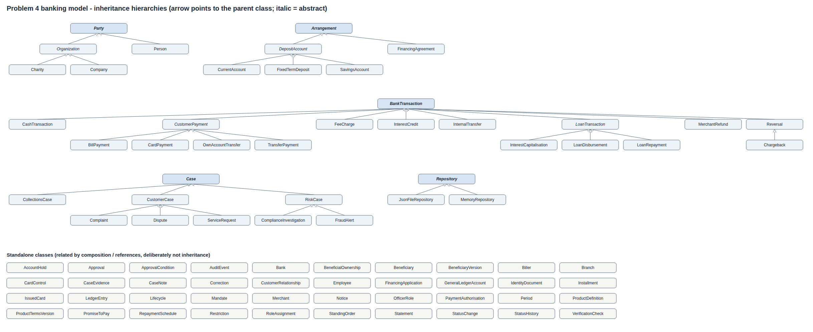

**Figures 2 to 5. UML class diagrams, one per hierarchy.** Each box shows only what that level *adds*: `+` class constants, `-` attributes set in that class's own `__init__`, and methods. Methods marked `[override]` (in red) replace or extend the parent's version. This is the visual answer to "why does the shared information belong at this level?" (section 6).

**Figure 2. Party hierarchy**

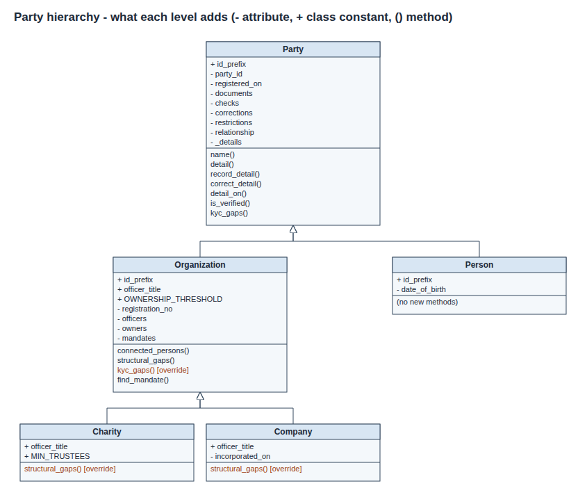

**Figure 3. Arrangement hierarchy**

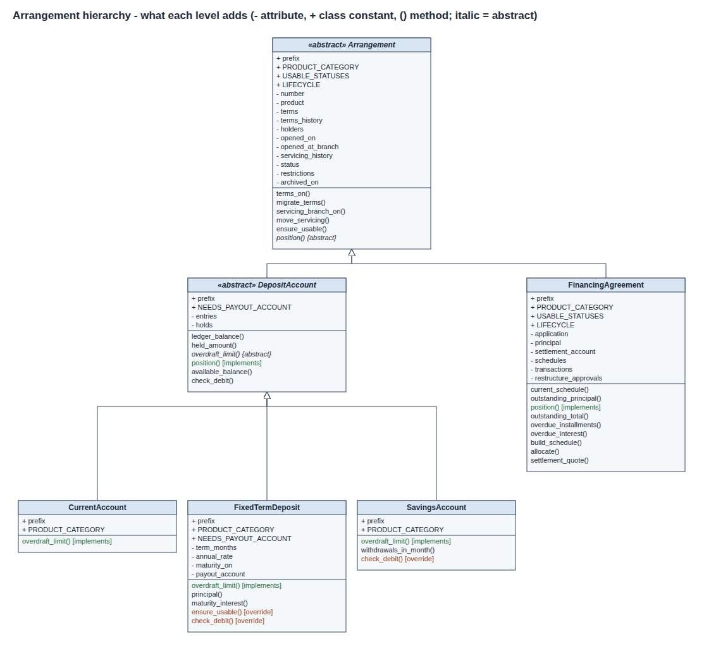

**Figure 4. BankTransaction hierarchy**

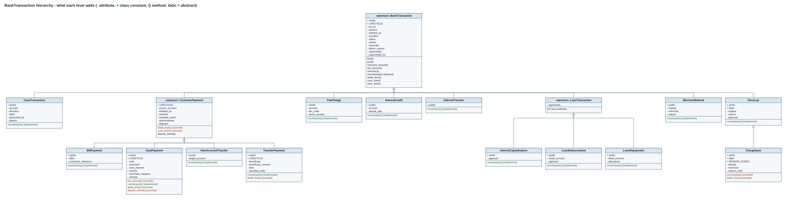

**Figure 5. Case hierarchy**

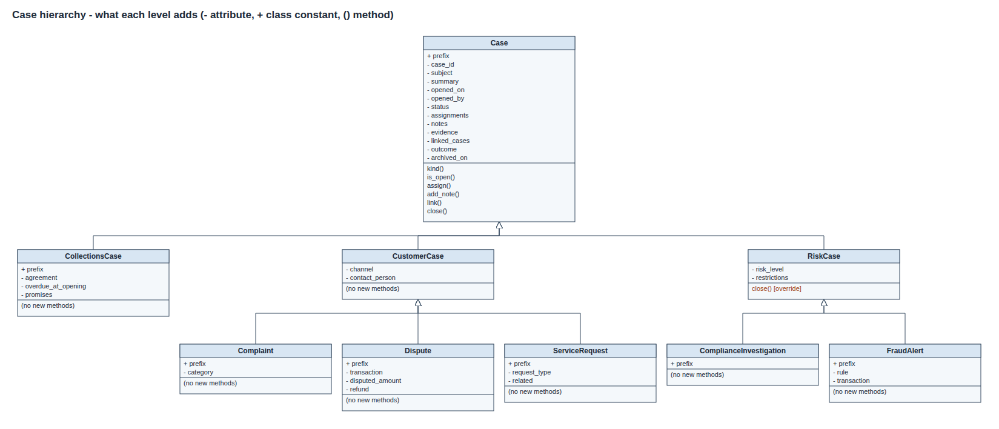

**Figures 6 to 8. Associations** (filled diamond = the owner keeps a dated history of these; arrow = reference)

**Figure 6. Parties, roles and staff**

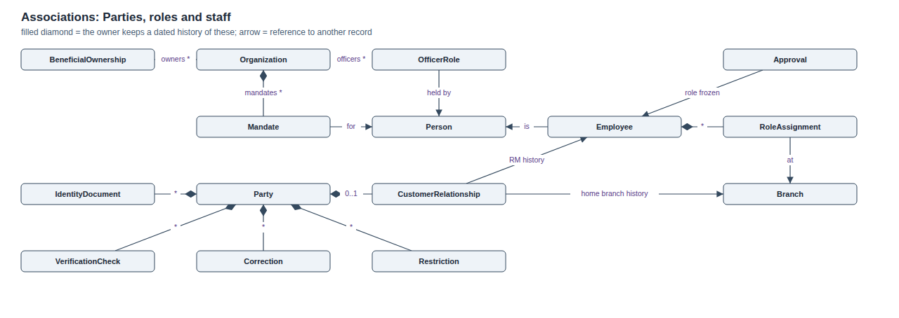

**Figure 7. Products, accounts and payments**

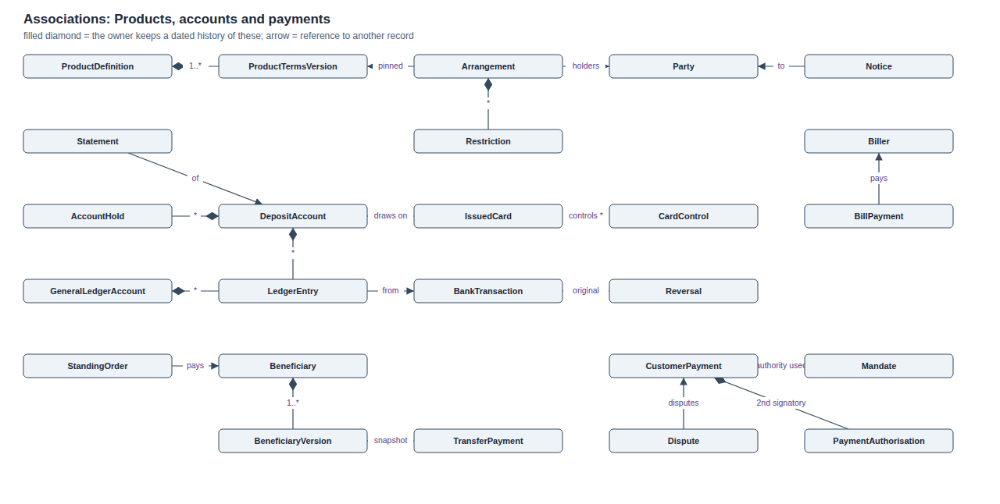

**Figure 8. Lending and cases**

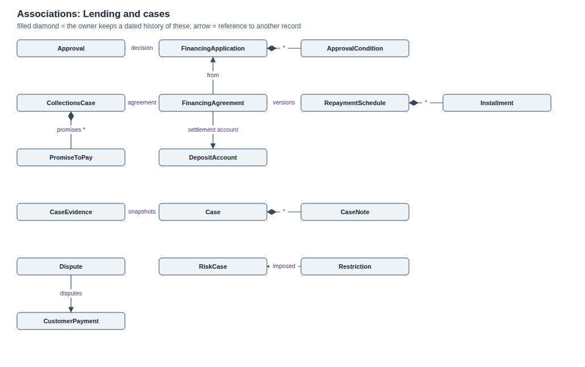

**Key associations** (composition and references; these are the relationships that were deliberately *not* modelled as inheritance):

| From | To | Kind | Why it matters |
|---|---|---|---|
| `Organization` | `OfficerRole`, `BeneficialOwnership`, `Mandate` | owns a history of | Roles start and end without deleting anything |
| `OfficerRole`, `Mandate`, `BeneficialOwnership` | `Person` | refers to | One person, many capacities |
| `Party` | `IdentityDocument`, `VerificationCheck`, `Correction`, `Restriction` | owns a history of | KYC and corrections are dated |
| `Party` | `CustomerRelationship` | 0..1 | Being a customer is a relationship, not a type |
| `CustomerRelationship` | `Branch`, `Employee` | period history | Home branch and RM on any date |
| `Employee` | `Person`, `RoleAssignment` | refers to / history | Employees can also be customers; roles change |
| `Approval` | `Employee` | freezes role and branch | Old decisions show the role held then |
| `ProductDefinition` | `ProductTermsVersion` | 1..* | Terms are versioned |
| `Arrangement` | `ProductTermsVersion` | pinned + history | Old customers keep old terms until migrated |
| `DepositAccount`, `GeneralLedgerAccount` | `LedgerEntry` | owns | Balances are derived |
| `LedgerEntry` | `BankTransaction` | produced by | Every entry is explainable |
| `Beneficiary` | `BeneficiaryVersion` | 1..* | Payee details are versioned |
| `TransferPayment` | `BeneficiaryVersion` | snapshot | Old payments keep the details used |
| `CustomerPayment` | `Mandate`, `PaymentAuthorisation` | authority used | Authority provable after revocation |
| `IssuedCard` | `DepositAccount`, `IssuedCard` | draws on / replaces | Replacement chain |
| `IssuedCard` | `CardControl` | owns a history of | Controls in force on any date |
| `BillPayment` | `Biller` | pays | Biller can be retired without touching past payments |
| `CollectionsCase` | `PromiseToPay` | owns | Promises are marked kept or broken, never edited |
| `FixedTermDeposit` | `DepositAccount` | payout account | Where principal and interest go at maturity |
| `Reversal` | `BankTransaction` | original | Counter-record, not an edit |
| `FinancingApplication` | `Approval`, `ApprovalCondition` | decision, conditions | Evidence of why the bank lent |
| `FinancingAgreement` | `RepaymentSchedule` -> `Installment` | versions | Restructure supersedes, never edits |
| `Case` | `CaseEvidence`, `CaseNote`, linked `Case`s | owns | Evidence snapshots survive corrections |
| `RiskCase` | `Restriction` | imposed | A risk case cannot close while its restrictions are live |

Complete class list by area:

| Area | Classes |
|---|---|
| Time, lifecycles and audit | `Period`, `StatusChange`, `StatusHistory`, `Lifecycle`, `AuditEvent` |
| Parties and KYC | `Party`, `Person`, `Organization`, `Company`, `Charity`, `IdentityDocument`, `VerificationCheck`, `Correction`, `OfficerRole`, `BeneficialOwnership`, `Mandate`, `PaymentAuthorisation`, `CustomerRelationship` |
| Bank organisation | `Branch`, `Employee`, `RoleAssignment`, `Approval` |
| Bank's own books | `GeneralLedgerAccount` |
| Products | `ProductDefinition`, `ProductTermsVersion` |
| Arrangements | `Arrangement`, `DepositAccount`, `CurrentAccount`, `SavingsAccount`, `FixedTermDeposit`, `FinancingAgreement`, `LedgerEntry`, `AccountHold`, `Restriction` |
| Financing | `FinancingApplication`, `ApprovalCondition`, `RepaymentSchedule`, `Installment` |
| Payments | `Beneficiary`, `BeneficiaryVersion`, `StandingOrder`, `Biller`, `Merchant`, `BankTransaction`, `CustomerPayment`, `TransferPayment`, `CardPayment`, `BillPayment`, `OwnAccountTransfer`, `CashTransaction`, `FeeCharge`, `InterestCredit`, `Reversal`, `Chargeback`, `MerchantRefund`, `InternalTransfer`, `LoanTransaction`, `LoanDisbursement`, `LoanRepayment`, `InterestCapitalisation` |
| Cards | `IssuedCard`, `CardControl` |
| Cases | `Case`, `CaseNote`, `CaseEvidence`, `CustomerCase`, `ServiceRequest`, `Dispute`, `Complaint`, `RiskCase`, `FraudAlert`, `ComplianceInvestigation`, `CollectionsCase`, `PromiseToPay` |
| Communications | `Statement`, `Notice` |
| Application service | `Bank` |
| Rule violations | `BankingError`, `KycIncomplete`, `AuthorityError`, `RestrictionViolation`, `ProductNotAvailable`, `InsufficientFunds`, `InvalidStateError` |


**For presenting.** The diagrams above carry every attribute and method, which makes them too dense for a projector. `tools/make_slide_diagrams.py` draws large 16:9 versions from the same classes: an overview of the four hierarchies and the standalone classes that connect them, and one diagram per hierarchy with a single line saying what each level adds (`docs/slide_*.png`). GitHub regenerates them on every push and fails if they no longer match the code.

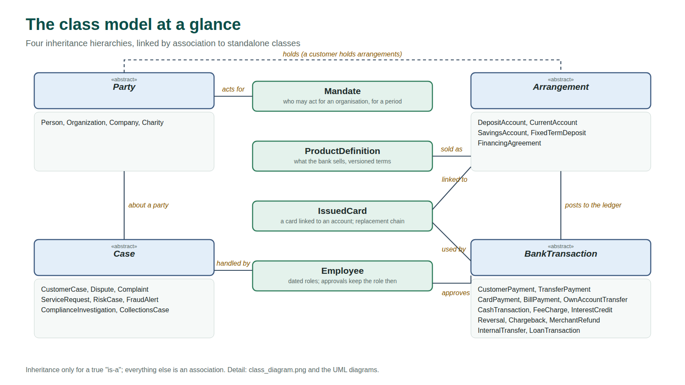

### 4.1 Behaviour: the main workflows as flowcharts

The class diagrams above show the structure. These six flowcharts show the behaviour: the order in which the code checks each rule and where a refusal ends the flow. Each one was traced from the method it describes, so the order of the decisions is the order of the checks in `banking_system.py` / `banking_gui.py`. They are drawn from code by `tools/make_flowcharts.py` using the standard flowchart symbols (ISO 5807):

| Symbol | Shape | Meaning in these charts |
|---|---|---|
| Terminator | Rounded "stadium" (green) | Start or normal end of the flow |
| Terminator | Rounded "stadium" (red) | The flow ends because a rule refused it (error raised, or the record kept as FAILED / DECLINED / REJECTED) |
| Process | Rectangle | One step the code performs |
| Decision | Diamond | A yes / no rule; every diamond has exactly one Yes and one No exit |
| Input / output | Parallelogram | Data coming in (an instruction) or going out (a printed report, a banner) |
| Predefined process | Rectangle with double sides | A named `Bank` operation described elsewhere (for example `post()`, `verify_party()`) |
| Data store | Cylinder | Stored records: ledger entries and the append-only audit log |

**Flowchart 1. Program overview:** what `python banking_system.py` does for each command-line option, and how the demonstration reaches a zero trial balance.

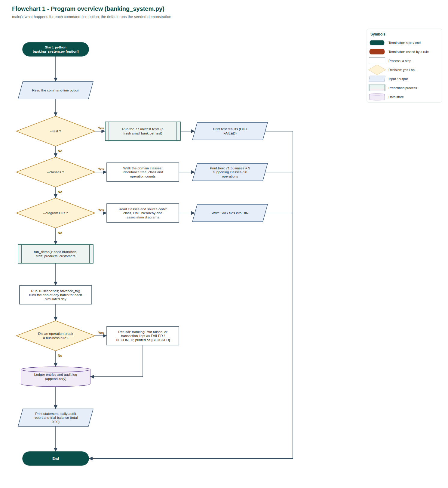

**Flowchart 2. Customer onboarding and account opening:** a failed document check is recorded (never deleted); KYC gaps block onboarding; an organisation needs its directors or trustees and owners verified first.

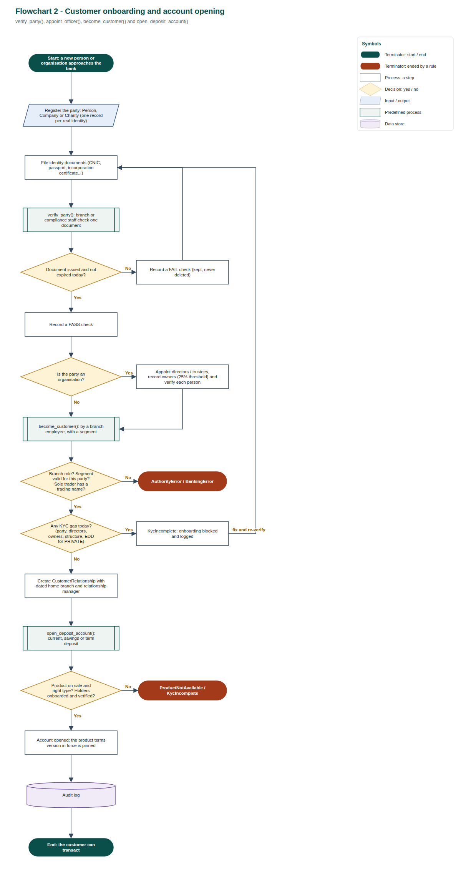

**Flowchart 3. Transfer payment** (`initiate_transfer`, `authorise_payment`, `release_transaction`): beneficiary, authority, funds, dual control and the PKR 1,000,000 compliance hold, in the order the code checks them.

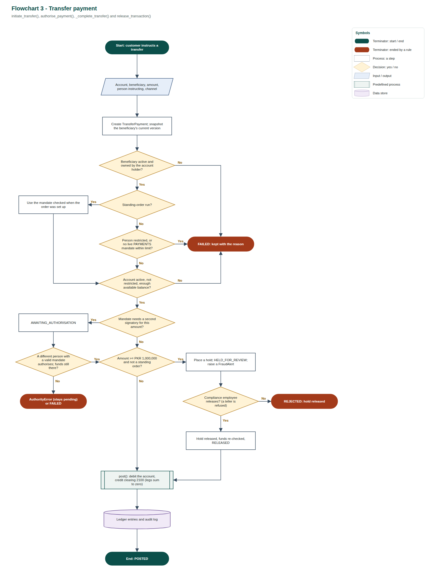

**Flowchart 4. Card purchase** (`card_purchase`): every refusal is a DECLINED payment kept with its reason; the card used is remembered so the history survives replacement.

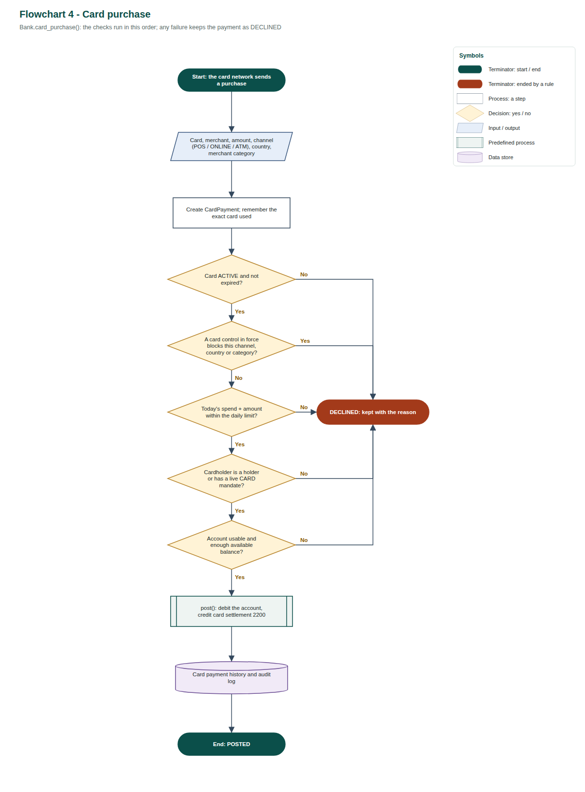

**Flowchart 5. Financing lifecycle:** delegated credit authority, conditions before disbursement, arrears and collections, restructuring (a new schedule version, the old one kept) and settlement.

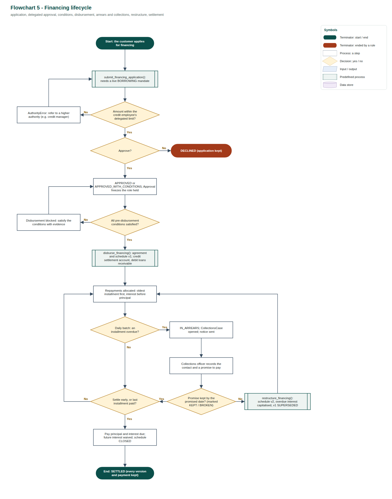

**Flowchart 6. Desktop front end** (`banking_gui.py`): sign in as staff or as a customer; every action calls one `Bank` operation and the result decides the banner colour; no rule lives in the GUI.

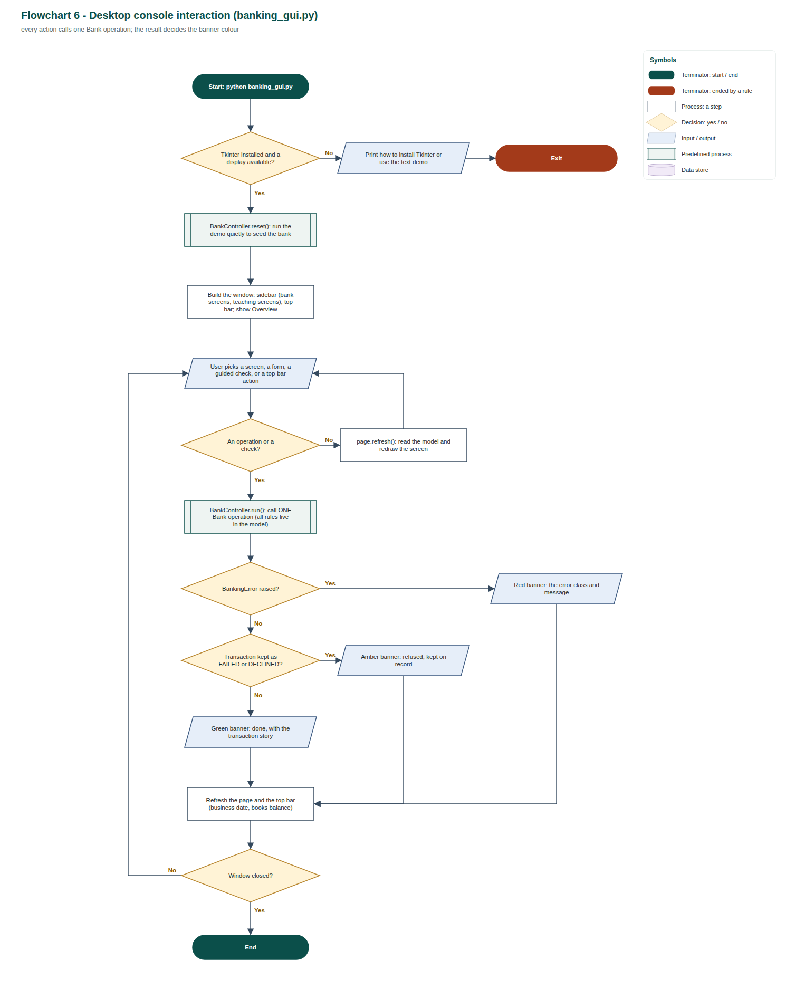


### 4.2 Lifecycles as UML state machine diagrams

The flowcharts show what an operation checks. These diagrams show what can happen to a record over its whole life. They are drawn by `tools/make_state_diagrams.py` directly from each class's `LIFECYCLE` declaration (section 6.2), the same object that `StatusHistory` enforces, so a move that is not on the diagram cannot happen in the code. Notation: filled circle = initial state, rounded rectangle = state, labelled arrow = transition with the operation that causes it, ringed circle = final state. In State machine 1 the colour of each state shows which class level introduced it.

**State machine 1. TransferPayment:** statuses inherited from `BankTransaction` (blue) and `CustomerPayment` (green), plus the compliance hold added by `TransferPayment` (amber).

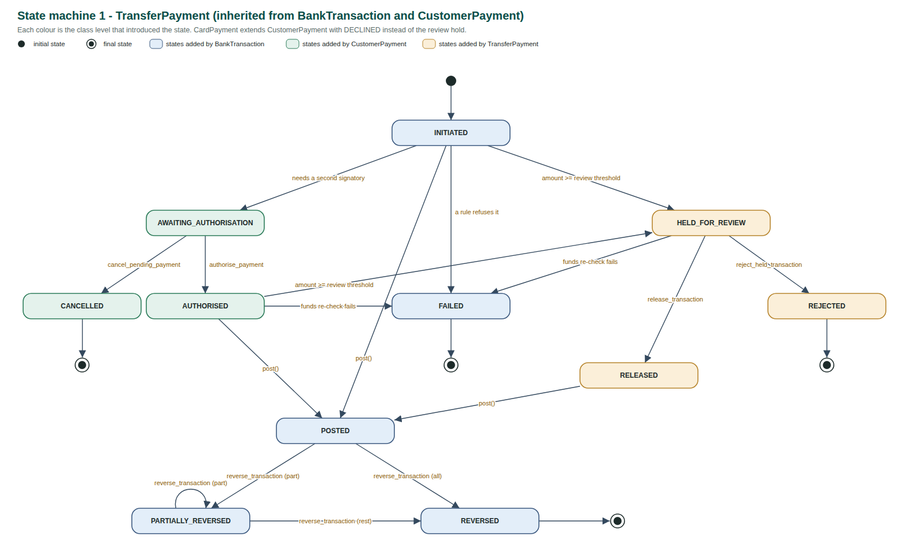

**State machine 2. IssuedCard:** only a card reported lost can be reactivated; a destroyed or cancelled card is final.

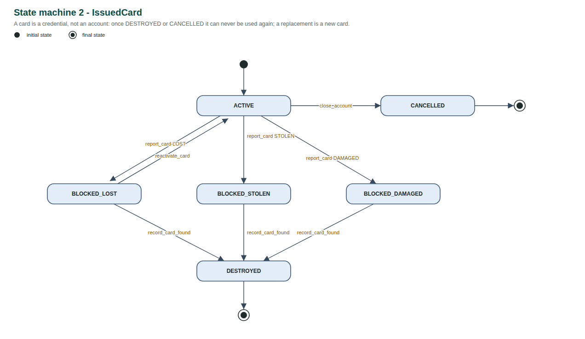

**State machine 3. FinancingApplication and FinancingAgreement.**

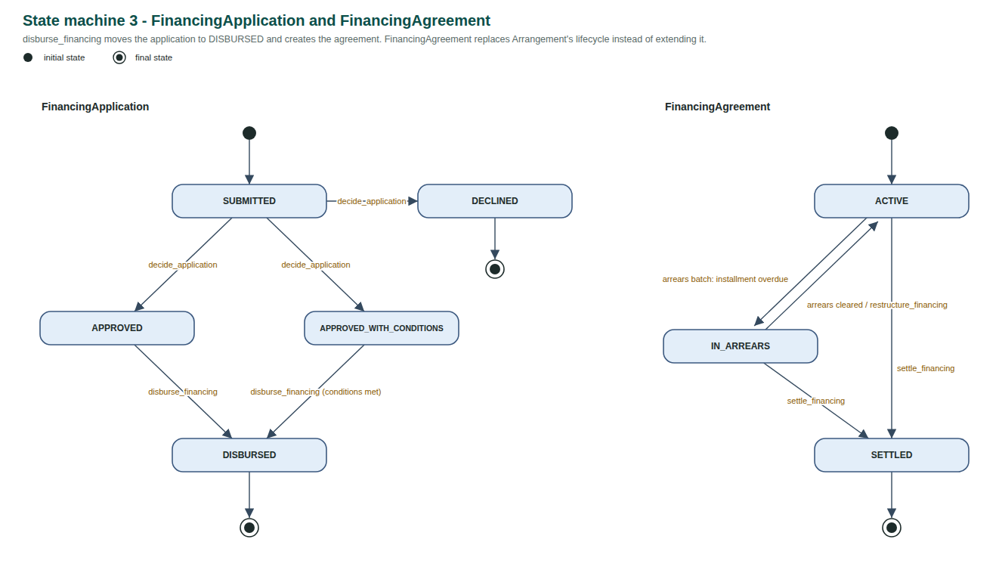

**State machine 4. The other records with a lifecycle.** Closing, ending, cancelling or deleting is always a move to a final state; the earlier statuses stay in the history.

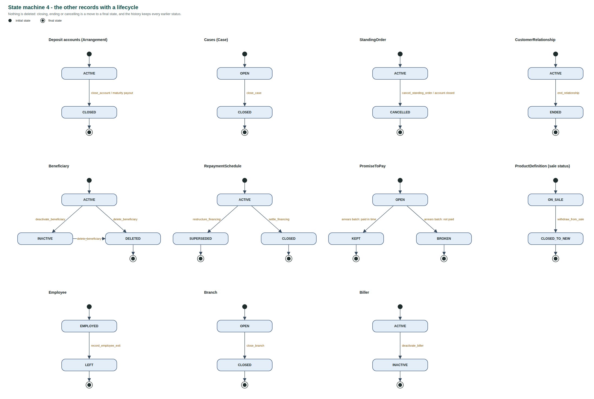

### 4.3 Objects working together: a UML sequence diagram

The class diagrams show what each class is, the flowcharts the order of the checks, and the state diagrams a record's whole life. A sequence diagram shows the remaining view: which *objects* send which messages to each other, in time order, during one real case. It follows scenario 2 (TRF-002, a PKR 1,500,000 company payment) through three operations on two dates: Hamza starts it, the mandate's dual-control threshold makes it wait for Ayesha, her approval sends it into a compliance hold with a fraud alert, and Kamran releases it three days later.

Notation (UML 2): a stick figure is an actor (a person using the system); a box with an underlined name is one object (`TRF-002 :TransferPayment`); the dashed line below it is its lifeline; a solid arrow with a filled head is a call; a dashed arrow with an open head is a return; a dashed arrow marked «create» creates an object, whose box starts at that point; the narrow bar on `:Bank` shows one operation in progress.

The diagram is drawn by `tools/make_sequence_diagram.py`, which runs the demonstration and fills in every label from the records (account, mandates, amounts, alert, dates). It refuses to draw if the status changes it shows differ from the status trail recorded on TRF-002, and CI regenerates it on every push, so it cannot drift from the code.

**Sequence diagram 1. A large transfer:** the same three objects (`:Company` for the mandate, `:CurrentAccount` for the funds, `:TransferPayment` for the status) are asked again at each step, because authority and funds can change between the request and the approval.

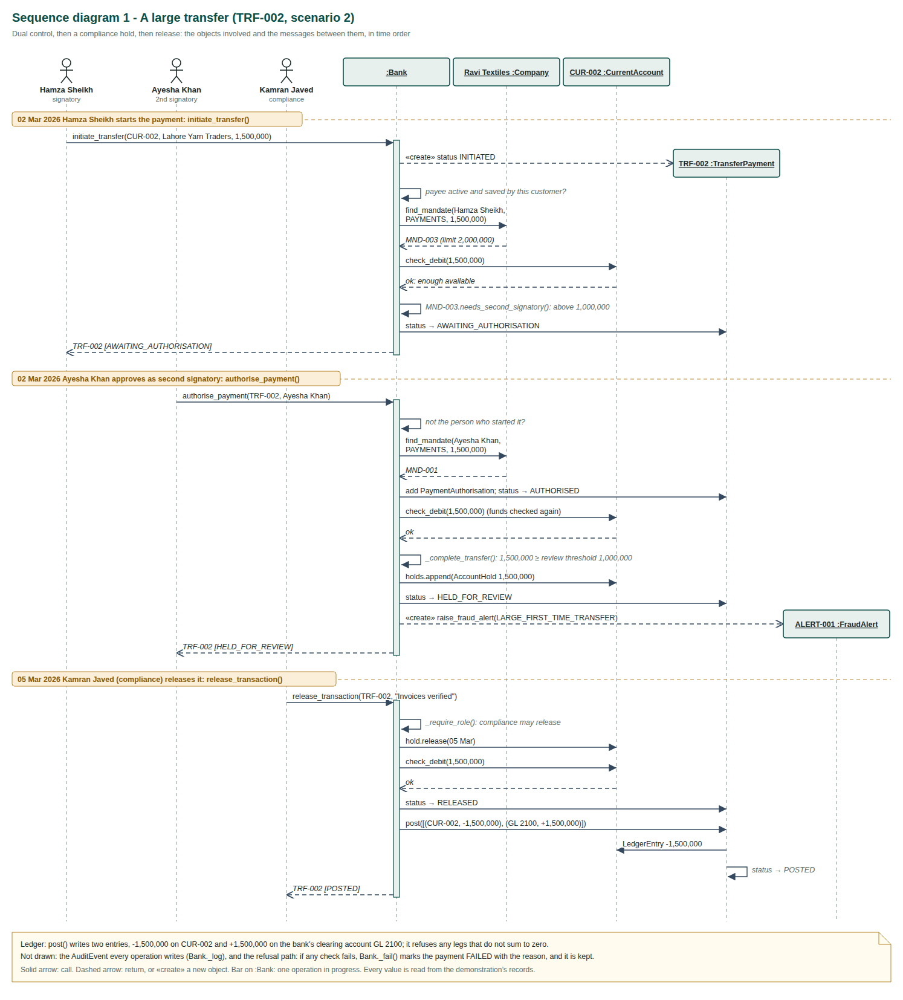

---

## 5. Implementation and operations

`banking_system.py` is organised in 16 numbered parts (model, service, demo, tests, diagram, command line), each with a header comment. Every class and every public operation has a docstring that states the rule it enforces.

`Bank` exposes 98 public operations. Each one checks the relevant rule, records the change as new data and writes an `AuditEvent`. The brief says trivial operations do not count, so they are classified honestly:

| Kind | Count | Operations |
|---|---|---|
| Commands (create, update, assign, approve, cancel, transfer, close, retire, archive, delete, status change) | 80 | every operation in the table below except those in the next two rows |
| Batch processes run by the simulated clock | 6 | `advance_to`, `run_standing_orders`, `run_arrears_check`, `charge_monthly_fees`, `credit_savings_interest`, `run_term_deposit_maturity` |
| Views, historical queries and reports | 12 | `authority_on`, `capacities_of`, `transaction_story`, `daily_report`, `trial_balance`, `relationship_history`, `party_snapshot`, `approvals_and_authority_audit`, `search_transactions`, `retention_until`, `active_customers`, `active_arrangements` |

Even counting only the 80 commands, the model is more than twice the brief's minimum of 30. The brief's verbs are all present: create (`register_person`, `open_deposit_account`), view (the query row), update (`amend_beneficiary`, `correct_party_detail`), delete (`delete_beneficiary`, `request_deletion`), assign (`assign_case`, `assign_relationship_manager`), cancel (`cancel_pending_payment`, `cancel_standing_order`), transfer (`transfer_between_accounts`, `close_branch`), approve (`decide_application`, `authorise_payment`), retire (`withdraw_from_sale`, `deactivate_biller`), archive (`archive_record`) and status management (`report_card`, `impose_restriction`).

| Group | Operations |
|---|---|
| Branches and staff | `open_branch`, `hire_employee`, `change_role`, `record_employee_exit`, `close_branch` |
| Parties and KYC | `register_person`, `register_company`, `register_charity`, `add_identity_document`, `verify_party`, `appoint_officer`, `end_officer_role`, `record_beneficial_owner`, `grant_mandate`, `revoke_mandate`, `correct_party_detail`, `become_customer`, `assign_relationship_manager`, `end_relationship` |
| Products | `define_product`, `revise_product_terms`, `withdraw_from_sale`, `migrate_terms` |
| Accounts, deposits and cash | `open_deposit_account`, `close_account`, `deposit_cash`, `withdraw_cash`, `transfer_between_accounts`, `break_term_deposit`, `run_term_deposit_maturity`, `charge_fee`, `charge_monthly_fees`, `credit_savings_interest`, `generate_statement` |
| Payments | `add_beneficiary`, `amend_beneficiary`, `deactivate_beneficiary`, `delete_beneficiary`, `initiate_transfer`, `authorise_payment`, `cancel_pending_payment`, `release_transaction`, `reject_held_transaction`, `reverse_transaction`, `repost_card_payment`, `create_standing_order`, `cancel_standing_order`, `run_standing_orders`, `register_biller`, `deactivate_biller`, `pay_bill` |
| Cards | `issue_card`, `record_merchant`, `card_purchase`, `merchant_refund`, `report_card`, `replace_card`, `record_card_found`, `reactivate_card`, `change_card_limit`, `add_card_control`, `remove_card_control` |
| Financing and collections | `submit_financing_application`, `attach_application_document`, `decide_application`, `satisfy_condition`, `disburse_financing`, `repay_financing`, `run_arrears_check`, `restructure_financing`, `settle_financing`, `record_collections_contact` |
| Cases | `raise_service_request`, `raise_fraud_alert`, `open_investigation`, `assign_case`, `add_evidence`, `impose_restriction`, `lift_restriction`, `log_complaint`, `open_dispute`, `resolve_dispute`, `close_case` |
| Retention | `archive_record`, `request_deletion`, `retention_until`, `active_customers`, `active_arrangements` |
| History, audit and reporting | `authority_on`, `capacities_of`, `transaction_story`, `search_transactions`, `daily_report`, `trial_balance`, `relationship_history`, `party_snapshot`, `approvals_and_authority_audit`, `advance_to` (simulated clock with an end-of-day batch) |

Every posting goes through `BankTransaction.post`, which refuses any set of legs that does not sum to zero. The demonstration ends with a trial balance that totals zero across all customer and bank accounts: a whole-system check that no scenario created or lost money.

Two conventions worth defending: payments that break a rule return a transaction with status `FAILED` or `DECLINED` (a failed payment is itself a record the bank must keep), while other rule violations raise a `BankingError` subclass (nothing should be created).

**Automated tests.** 84 independent tests (`python banking_system.py --test`), run by the file's own `TestRunner` (section 5.3). Each builds a small fresh bank and checks one rule or historical guarantee. They include one regression test for every defect fixed during the code review (`docs/Code_Review.md`), eleven tests for the features added after checking the model against every line of the brief (`BriefCoverageTests`), five tests that check the brief's own requirements from the code (at least 30 classes and 30 operations, multi-level inheritance, that the diagrams name only real classes, that the whole demonstration runs with a zero trial balance, and that the file imports nothing but `sys`), three tests for the IBAN and card-number checks (section 5.4), three substitution tests (`SubstitutionTests`, section 6.4), seven abstraction tests (`AbstractionTests`: the hierarchy roots cannot be instantiated, every leaf class is concrete, the polymorphic methods replace the old type checks, a merchant is a counterparty linked to every card payment made there, and every upheld card dispute in the demonstration became a `Chargeback`), two card tests from the research (`CardRefundAndChargebackTests`: a merchant refund is a new credit that leaves the purchase posted and limits what can still be disputed; a chargeback needs a scheme reason code and cannot itself be reversed) and four lifecycle tests (`LifecycleTests`: every status change in the demonstration followed its class's state machine, an illegal move is refused even when the `Bank` is bypassed, lifecycles are inherited and extended, and every state machine is well formed).

---

### 5.1 How the class count holds up under a strict reading

The brief says artificial classes added only to meet a count do not qualify. So every one of the 74 business classes was sorted by what it actually contains (the 16 supporting classes are already counted separately):

| Group | Count | What qualifies a class | Examples |
|---|---|---|---|
| Classes with their own behaviour | 51 | At least one method, override or rule of its own | `Money` (paisa rounding), `Iban` (check digits), `CardNumber` (Luhn), `Party`, `Organization`, `SavingsAccount` (monthly limit), `FixedTermDeposit` (no withdrawal before maturity), `Mandate` (limits, dual control), `CustomerPayment`, `Reversal`, `RiskCase` (cannot close while a restriction is in force) |
| Record classes that keep history | 20 | Several fields, each a fact the brief requires to be kept after things change | `VerificationCheck`, `Correction`, `OfficerRole`, `BeneficiaryVersion`, `PaymentAuthorisation`, `Approval` (role at the time), `CaseEvidence` (snapshot), `PromiseToPay` |
| Type-only subclasses | 3 | Little or no data of their own; kept for a stated reason | see below |

**The three small subclasses, and why they stay:**

- **`LoanTransaction`** (adds only `agreement`): the abstract parent that groups disbursement, repayment and interest capitalisation, so "every movement on this loan" is one query and the agreement link is declared once.
- **`Complaint`** (adds `category`): a complaint is a different customer case from a dispute or a service request, with its own reference series (`CMP-`), and it is counted and reported separately.
- **`ComplianceInvestigation`** (no own fields): a risk case opened by compliance staff rather than by a monitoring rule. Unlike `FraudAlert`, it has no triggering rule or transaction, which is exactly why it is a sibling and not a subclass. It keeps its own reference series (`CMPL-`).

**The strict count:** even counting only the 51 classes with their own behaviour, the model is well above the brief's minimum of 30. The record classes are what keep history meaningful (the brief's common rule on historical records), so they are counted as meaningful too, but they are not needed to pass the threshold.

### 5.2 Saving and loading the whole bank (files and JSON)

`Repository` (a small supporting hierarchy, not one of the four banking hierarchies) saves the entire bank as JSON text and loads it back exactly: every object and its full history, including status histories, versions and the audit log. A saved bank carries on where it stopped: new reference numbers continue from the saved counters, and the lifecycles still refuse illegal moves.

| Class | Inherits from | What the level adds |
|---|---|---|
| `Repository` | (abstract) | The JSON format, shared by every repository: `save()` and `load()` as template methods; `encode()` and `decode()` |
| `JsonFileRepository` | `Repository` | Keeps the text in a file on disk |
| `MemoryRepository` | `Repository` | Keeps the text in memory, so the tests need no files |

**How the format works.** Each object is saved once, as its class name and its fields. A link to another object is saved as `{"$ref": n}`, so an object shared by several records (an employee who approved many payments, for example) is still one object after loading, and links in both directions are no problem. Dates, money and exact numbers keep their types (`{"$date": ...}`, `{"$money": ...}`, `{"$exact": ...}`), and the JSON text itself is written and read by the model's own `Json` and `JsonReader` classes (section 5.3). A lifecycle is saved by its name (for example `TransferPayment.LIFECYCLE`), because it is part of the class, not data. Encoding is iterative, not recursive, so long chains of linked records cannot exceed Python's recursion limit.

**Why a hierarchy.** What changes between repositories is only *where* the text is kept; the format must be identical, or a bank saved by one could not be read by another. So the format lives once in the parent, and each subclass implements two small methods (`_write`, `_read`). A database repository would be a third subclass.

**Proof.** Four tests: saving a loaded bank gives byte-for-byte the same JSON (all 1,375 objects of the demo bank); the loaded bank keeps its balances and answers history questions (Bilal's mandate on 11 April 2026); it carries on (a new deposit posts under a new reference, and a destroyed card still cannot become active); and the model's JSON reader and writer agree with each other, refuse malformed text and refuse a missing file. From the command line: `python banking_system.py --save bank.json` and `--load bank.json`. In the GUI: Save and Open in the top bar.

### 5.3 Building blocks written in Python instead of libraries

The project is about classes, so the program uses its own classes even for the pieces that Python's libraries usually provide. Each one is small, has a docstring that explains the idea, and is covered by the tests. The only imports are `sys` (for the command-line options and the exit code) and `from __future__ import annotations` (a language directive that lets Python 3.9 read type hints such as `Organization | None`). A test reads the file's own source and fails if any other import appears.

| Own class | In place of | How it works |
|---|---|---|
| `Exact` | `decimal` | A number held as a fraction of two whole numbers, reduced with Euclid's greatest common divisor, so 0.1 + 0.2 is exactly 0.3. It rounds only when asked (half up, or half to even), and supports arithmetic, comparison and formats such as `{:,.2f}` and `{:.2%}` |
| `Money` (subclass of `Exact`) | `Decimal.quantize` | An amount in rupees, rounded half up to the paisa when it is created (Fowler's Money pattern). Money plus money is money; money times a rate is an exact number, rounded again only when it becomes money |
| `Date`, `Days` | `datetime` | The Gregorian calendar: a year is a leap year if divisible by 4, except century years not divisible by 400. A date converts to a day number, so adding days or measuring the gap between two dates is whole-number arithmetic; `add_months` keeps the day within the month |
| `Abstract`, `@abstract` | `abc` | `@abstract` marks a method; `Abstract.__new__` refuses to create an object while a marked method has not been overridden, with the same `TypeError` message Python gives |
| `Json`, `JsonReader` | `json` | The writer escapes text and indents nested objects. The reader is a recursive-descent parser: one method for each rule of the JSON grammar (RFC 8259: value, object, array, string, number), so malformed text is refused with the position of the mistake |
| `TestCase`, `TestRunner` | `unittest` | Kent Beck's xUnit design: each test method runs on a fresh object after `setUp`; assertions raise `TestFailure`; `assertRaises` works in a `with` block; the runner finds every `TestCase` subclass, reports failures and errors separately, and returns the exit code CI checks |
| `DemoLog` | `io`, `contextlib` | Collects the demonstration's lines, printed or silent, so the GUI and the tests can run the demonstration without capturing the screen |
| `SourceIndex` | `inspect`, `ast` | Reads the file's own source to find a method and the attributes `__init__` assigns, for the UML diagrams |

**Why this suits an OOP project.** Each library replaced is a small design problem with a class-shaped answer, and the answers use the assessed concepts. `Money` inherits from `Exact` because money *is* an exact number with one extra rule: it inherits all the arithmetic and changes only how a value is created. `Abstract` is the base class of every abstract root in the model (`Party`, `Arrangement`, `BankTransaction`, `Case`, `Repository`). Every test class inherits its assertions from `TestCase`.

**The GUI and the assistant.** `banking_gui.py` uses Tkinter, which draws the window and comes with Python, and nothing else: dates, money and saving come from the model's classes, and its text formatting reads words character by character instead of using regular expressions. `banking_assistant.py` reads a request word by word, uses the model's `Json` and `TestRunner`, and imports Anthropic's client only when Claude is switched on; while Claude answers, the GUI waits on a worker thread so the window stays responsive. Neither file is needed to run or mark the model.

### 5.4 Account and card numbers that check themselves

Two checks that banks run before money moves were added from the research (sources 9 to 11). Both are value classes: created from text, they refuse anything invalid and never change afterwards.

**`Iban`.** A Pakistani IBAN has 24 characters: `PK`, two check digits, a four-letter bank code and a 16-digit account number, for example `PK36 SCBL 0000 0011 2345 6702` (the IBAN Registry's example). The check digits are chosen so that, after moving the first four characters to the end and replacing each letter by two digits (A = 10 ... Z = 35), the whole number leaves a remainder of 1 when divided by 97 (ISO 7064 MOD 97-10). `Iban.remainder` does this long division one digit at a time, as on paper, and `Iban.build` works out the check digits for a domestic account number. A mistyped digit changes the remainder, so `add_beneficiary` and `amend_beneficiary` refuse it before any payment can use it; the bank code must also match the bank named (a UBL IBAN entered as HBL is refused). Every payee in the demonstration and the tests has a valid IBAN, and the last four digits shown on payments are unchanged.

**`CardNumber`.** A card number (ISO/IEC 7812) is a six-digit issuer prefix (BIN), the account digits and a final Luhn check digit: from the right, every second digit is doubled (9 is subtracted when that gives two digits), and the total must end in 0. This catches every single mistyped digit and most swapped neighbours. `IssuedCard` now issues a Luhn-valid number. PCI DSS requires a stored card number to be unreadable, and truncation is one accepted method, so `CardNumber` keeps only the first six and last four digits; screens, the audit log and saved files show `4213 **** **** 9193`. A test checks that the object holds no other digits.

| Test | What it proves |
|---|---|
| `test_iban_check_digits_catch_mistakes` | The registry's example is valid and `build` reproduces it; a changed check digit, a missing digit and a foreign country code are refused |
| `test_payee_iban_must_match_its_bank` | A payee whose IBAN belongs to another bank is refused, and nothing is saved |
| `test_card_number_has_a_luhn_check_digit_and_is_kept_truncated` | The standard Luhn examples; one mistyped digit is refused; an issued card keeps only the first six and last four digits |

## 6. Inheritance relationships explained

**Party -> Person / Organization -> Company / Charity (multi-level).** Every party has an identity, documents, verification checks, corrections, restrictions and possibly a customer relationship, so these live in `Party`. `Party.kyc_gaps` is a template method: the party's own verification, then two abstract hooks, `structural_gaps` (rules about its make-up) and `connected_persons` (people whose verification it depends on). `Person` implements both as "nothing": a person has no governance structure and answers only for itself. `Organization` adds what only legal entities have (registration number, officers, beneficial owners, mandates) and implements `connected_persons` as its active officers and owners at or above 25%, which gives the stricter KYC rule for free. It is still abstract, because `Company` and `Charity` differ in real governance: a company needs an active director and a charity at least two trustees. Each implements `structural_gaps` with the rule true at that level. That is why the hierarchy has three levels rather than two.

**Arrangement -> DepositAccount -> CurrentAccount / SavingsAccount / FixedTermDeposit (multi-level), and Arrangement -> FinancingAgreement.** Everything a customer holds has a product, pinned terms and terms history, holders, an opening branch, a servicing-branch history, a status and restrictions: that is `Arrangement`. Only deposit accounts hold customer money, so ledger entries, holds and ledger/available balance belong to `DepositAccount`. A current account adds an overdraft (overrides `overdraft_limit`); a savings account adds a monthly withdrawal limit (overrides `check_debit`); a fixed-term deposit adds a term, rate and maturity date, refuses debits before maturity (overrides `check_debit`) and accepts only one credit, the placement (overrides `ensure_usable`). All three still reuse the parent's ledger and balance logic unchanged. A financing agreement is also an arrangement (terms, holders, status), but it holds no customer money; it has schedules and installments instead, so it sits beside `DepositAccount`, not under it.

**BankTransaction -> CustomerPayment -> TransferPayment / CardPayment / BillPayment / OwnAccountTransfer (multi-level).** Every transaction has an amount, a status history, ledger entries and reversals. A customer payment is one a customer (or their representative) instructed, so it records who initiated it, the channel and the mandate used, and it can be disputed. Transfers add a beneficiary-version snapshot and a possible hold; card payments add the exact card, merchant, channel, country and merchant category (which card controls check); bill payments add the biller and consumer reference; own-account transfers add the target account. All four are disputable and subject to the same mandate and restriction rules because they inherit what makes them *customer* payments.

**BankTransaction -> LoanTransaction -> LoanDisbursement / LoanRepayment / InterestCapitalisation (multi-level).** All three belong to a financing agreement and move the bank's loans-receivable balance. A disbursement carries its approval, a repayment its installment allocations, and a capitalisation records overdue interest added to principal on restructuring (no customer cash moves, but the books must change).

**BankTransaction -> CashTransaction / FeeCharge / InterestCredit / Reversal / MerchantRefund / InternalTransfer.** These are transactions (they post and have statuses) but share nothing further with each other. A reversal is a transaction in its own right, not a flag on the original. A merchant refund is money the merchant sends back through the card scheme; it points to the purchase and its merchant. `InternalTransfer` is a bank-initiated movement no customer instructed (vault cash on branch closure, term-deposit payout).

**BankTransaction -> Reversal -> Chargeback (multi-level).** Everything a reversal has, a chargeback has too: an original transaction, counter-entries that mirror it, a staff approval, the rule that it cannot itself be reversed, and the effect of marking the original (partially) reversed. So `Chargeback` inherits all of it, and `Bank._counter_post` is shared by both. What a chargeback adds is only true at that level: it exists only for a *card* payment, only because a `Dispute` was upheld, it is claimed from a specific `Merchant` through the card scheme, and it carries the scheme reason code. `resolve_dispute` therefore asks the payment how it is refunded (`dispute_refund()`): `CardPayment` answers with a `Chargeback`, and every other customer payment with a plain `Reversal`. The level was found by research (source 5), not by looking for shared fields.

**Case -> CustomerCase -> ServiceRequest / Dispute / Complaint; Case -> RiskCase -> FraudAlert / ComplianceInvestigation (multi-level); Case -> CollectionsCase.** All cases have a subject, status history, assignments, notes, evidence and links. Customer cases arrive through a service channel from a contact person. Risk cases are bank-initiated, carry a risk level and the restrictions they imposed, and override `close()` so they cannot close while those restrictions are in force. This split lets the scenario keep the branch complaint and the compliance investigation as separate, linked records.

**BankingError -> specific errors.** Every rule violation is a banking error; the subclasses let the demonstration and the tests name *which* rule stopped an action.

### 6.1 Abstract classes and polymorphism

The brief states that abstraction, abstract base classes and polymorphism are not assessed. They are used here only where they make an inheritance decision enforceable rather than merely described: the level of the hierarchy that is abstract is exactly the level this report argues is "not a real thing on its own".

A real bank never holds "a party", "an arrangement", "a transaction" or "a case" that is not some specific kind, so the root of each hierarchy is an abstract base class (it inherits from the model's own `Abstract` class, section 5.3). Trying to create one raises `TypeError`, and a new subclass that forgets a required method cannot be instantiated at all. Each abstract method is one whose answer genuinely differs by class:

| Abstract class | Abstract method | Implemented by | Replaces |
|---|---|---|---|
| `Party` | `structural_gaps()`, `connected_persons()` (hooks of the `kyc_gaps` template) | `Person`; `Organization` (connected persons); `Company`, `Charity` (structure) | An `Organization.kyc_gaps` override |
| `Organization` | `structural_gaps()` (still open) | `Company`, `Charity` | A do-nothing default |
| `Arrangement` | `position()`: money held or owed | `DepositAccount` (ledger balance, held), `FinancingAgreement` (principal, owed) | A type check in the GUI |
| `DepositAccount` | `overdraft_limit()` | `CurrentAccount` (from terms), `SavingsAccount` and `FixedTermDeposit` (zero) | A silent zero default |
| `BankTransaction`, `CustomerPayment`, `LoanTransaction` | `counterparty()`: who is on the other side | all 12 concrete transaction classes | (new) |
| `Case` | `handler_roles()`: staff allowed to work it | `CustomerCase`, `RiskCase`, `CollectionsCase` | An `isinstance` chain in `Bank.assign_case` |

`BankTransaction.story_lines()` is also a template method: common lines first, then the hooks `detail_lines()` (extended by `CustomerPayment`, then by `TransferPayment` and `CardPayment` with `super()`) and `case_lines()` (disputes, only on customer payments). `Bank.transaction_story` used to test the transaction's type three times; it is now one line, `return txn.story_lines()`, and a test checks that neither it nor `assign_case` contains `isinstance`. In the UML diagrams, abstract classes and methods are in italics (the UML convention) and each method is marked `{abstract}`, `[implements]` (fills in a parent's abstract method) or `[override]` (replaces or extends a parent's working method).

### 6.2 Inherited state machines

Each class with a status declares its lifecycle once, as a `LIFECYCLE` class constant: the initial status, every allowed move labelled with the operation that causes it, and the final statuses. `StatusHistory` enforces it on every change, so an illegal move (a destroyed card becoming active again, a posted payment going back to pending) is refused wherever it is attempted, even by code that bypasses the `Bank`. Lifecycles are inherited like any other class attribute: `CashTransaction` uses `BankTransaction`'s unchanged, `CustomerPayment` extends it with dual control (`AWAITING_AUTHORISATION`, `AUTHORISED`, `CANCELLED`), `TransferPayment` extends that with the compliance hold and `CardPayment` with `DECLINED`. `FinancingAgreement` instead replaces `Arrangement`'s lifecycle, because a loan is never "closed" like an account; it is settled. The state diagrams in section 4.2 are drawn from these declarations.

---

### 6.3 What each level adds, and why it sits there

The same four hierarchies as tables, one row per level. The data and behaviour columns are taken from the code (they match the UML diagrams in section 4, which are generated from the classes); the last column is the reason the member sits at that level and not higher or lower.

**Parties**

| Level | Data it adds | Behaviour it adds or changes | Why at this level |
|---|---|---|---|
| `Party` (abstract) | `party_id`, documents, checks, corrections, restrictions, `relationship`, dated details | `kyc_gaps()` (template method), `is_verified()`, `detail_on()`, `correct_detail()`; abstract `structural_gaps()`, `connected_persons()` | Every person and organisation is identified, verified, corrected and restricted the same way |
| `Person` | `date_of_birth` | implements both hooks: nothing further to check | A person has no board and no owners |
| `Organization` (abstract) | `registration_no`, `officers`, `owners`, `mandates`; `OWNERSHIP_THRESHOLD` (25%) | implements `connected_persons()` (officers, owners of 25% or more); `find_mandate()` | Only legal entities have officers, owners and people acting for them; still abstract because the governance rule differs |
| `Company` | `incorporated_on` | `structural_gaps()`: an active director | Company law |
| `Charity` | `MIN_TRUSTEES` (2) | `structural_gaps()`: at least two trustees | Trust governance (A4) |

**Arrangements**

| Level | Data it adds | Behaviour it adds or changes | Why at this level |
|---|---|---|---|
| `Arrangement` (abstract) | `number`, `product`, pinned `terms` and `terms_history`, `holders`, branch history, `status`, `restrictions` | `terms_on()`, `migrate_terms()`, `ensure_usable()`, `servicing_branch_on()`; abstract `position()` | Anything a customer holds under a product's terms |
| `DepositAccount` (abstract) | ledger `entries`, `holds`; `NEEDS_PAYOUT_ACCOUNT` | `ledger_balance()`, `available_balance()`, `check_debit()`; `position()` = held; abstract `overdraft_limit()` | Only deposits hold the customer's money |
| `CurrentAccount` | (none) | `overdraft_limit()` from its terms | The only account that may go below zero |
| `SavingsAccount` | (none) | `overdraft_limit()` = 0; `check_debit()` adds the monthly withdrawal limit, then calls `super()` | A savings rule on top of the shared funds check |
| `FixedTermDeposit` | `term_months`, `annual_rate`, `maturity_on`, `payout_account` | `check_debit()` refuses before maturity; `ensure_usable()` allows one placement; `maturity_interest()` | Money locked for a term, paid out to another account |
| `FinancingAgreement` | `principal`, versioned `schedules`, `transactions`, `settlement_account` | `position()` = owed; `allocate()`, `outstanding_principal()`, `settlement_quote()` | Money owed, not held: a sibling of `DepositAccount`, not a child |

**Transactions**

| Level | Data it adds | Behaviour it adds or changes | Why at this level |
|---|---|---|---|
| `BankTransaction` (abstract) | `txn_id`, `amount`, `status`, ledger `entries`, `reversals`, `failure_reason`, `supersedes` | `post()` (the legs must sum to zero), `net_amount`, `story_lines()` (template method); abstract `counterparty()` | Every movement of money is posted, has a status and may be reversed |
| `CustomerPayment` (abstract) | `source_account`, `initiated_by`, `channel`, `mandate_used`, `authorisations`, `disputes`; dual-control states | extends `detail_lines()` and `case_lines()`; `dispute_refund()` = a `Reversal` | Only payments a customer instructed need authority, a second signatory and disputes |
| `TransferPayment` | `beneficiary`, `beneficiary_version`, `hold`, `standing_order`; compliance-hold states | `counterparty()`; extends `detail_lines()` | Only transfers leave the bank to a saved payee |
| `CardPayment` | `card`, `merchant`, `card_channel`, `country`, `merchant_category`, `refunds`; `DECLINED` | `net_amount` also subtracts merchant refunds; `dispute_refund()` = a `Chargeback` | Only card payments go through a card scheme |
| `BillPayment`, `OwnAccountTransfer` | biller and consumer reference; target account | `counterparty()` | Each adds only its own counterparty |
| `LoanTransaction` (abstract) and its three subclasses | `agreement`; then the approval, the allocations or the capitalisation approval | `counterparty()` in each subclass | Every movement on one loan, found in one place |
| `Reversal`, then `Chargeback` | `original`, `reason`, `approval`; then `dispute`, `merchant`, `reason_code` | `counterparty()`; `Chargeback` overrides it to name the merchant | A chargeback is a reversal with card-scheme obligations |

**Cases**

| Level | Data it adds | Behaviour it adds or changes | Why at this level |
|---|---|---|---|
| `Case` (abstract) | `case_id`, `subject`, `summary`, `status`, assignments, notes, evidence, links, `outcome` | `assign()`, `add_note()`, `link()`, `close()`; abstract `handler_roles()` | Every case is worked, recorded and closed the same way |
| `CustomerCase` | `channel`, `contact_person` | `handler_roles()`: branch staff | Raised by a customer through a channel |
| `Complaint`, `Dispute`, `ServiceRequest` | `category`; the payment, amount, reason and refund; the request type and related record | (data only) | Different records, each with its own reference series |
| `RiskCase` | `risk_level`, `restrictions` | `handler_roles()`: compliance; `close()` refuses while a restriction is in force | Opened by the bank, and may restrict the customer |
| `FraudAlert`, `ComplianceInvestigation` | `rule`, `transaction`; (none) | (data only) | Raised by a monitoring rule; opened by compliance staff |
| `CollectionsCase` | `agreement`, `overdue_at_opening`, `promises` | `handler_roles()`: collections | Overdue financing |

### 6.4 The design checked against SOLID and design patterns

The course's design principles (SOLID) and design patterns were used as a checklist against the finished code. The review found two places that broke the open/closed principle; both were fixed, and each fix is protected by a test.

**S: Single responsibility.** Most classes do one job: `Period` answers "was this valid on a date?", `StatusHistory` keeps and checks status changes, `Lifecycle` says which moves are allowed, `LedgerEntry` is one posting, `Iban` checks one account number, and `Repository` knows the file format while its subclasses only decide where the text is kept. The exception is `Bank` (about 1,380 lines, 98 public operations). It is the application service: each operation checks who is acting, asks the domain objects (`check_debit()`, `find_mandate()`, `kyc_gaps()`, the lifecycles) and records the result. The business rules themselves live in those classes, not in `Bank`. At a larger bank it would be split into services by area (section 10); that is the honest limit of a one-file model.

**O: Open/closed.** A new kind of thing is added by writing a subclass, without editing `Bank`: a deposit implements `overdraft_limit()` (and may extend `check_debit()`), a transaction `counterparty()`, a case `handler_roles()`, a storage place `_write()` and `_read()`, and a lifecycle extends its parent's with `Lifecycle.extend()`. The review found two places that still chose behaviour by type:

| Before | Problem | After |
|---|---|---|
| `open_deposit_account` tested `account_class is FixedTermDeposit` | A subclass of `FixedTermDeposit` (for example an Islamic term deposit) would have skipped the payout-account rule | A class constant, `NEEDS_PAYOUT_ACCOUNT`, inherited by every term deposit |
| `resolve_dispute` tested `isinstance(txn, CardPayment)` | A new disputable payment type would have meant editing `Bank` | The payment answers `dispute_refund()`: a `Reversal`, or a `Chargeback` for a card payment |

A test now defines an `IslamicTermDeposit(FixedTermDeposit)` inside the test and shows that the bank opens it, demands its payout account and refuses early withdrawals, with no change to `Bank`. The `isinstance` checks that remain in `Bank` (33) are almost all guards (an operation that applies to one kind only: `break_term_deposit` refuses anything but a term deposit) or filters (the collections cases of one loan). One still chooses behaviour: `authorise_payment` completes a bill payment differently from a transfer. It was left because only these two payments can wait for a second signatory, and each settles to a different ledger account.

**L: Liskov substitution.** Every subclass keeps its parent's promises, so code written for the parent works with any child. `DepositAccount.check_debit()` promises "return, or refuse with a `BankingError`". `SavingsAccount` and `FixedTermDeposit` refuse in more situations, but only with the same kind of error, and every caller (`initiate_transfer`, `withdraw_cash`, the standing-order run) already handles a refusal, so no caller changes. The rejected inheritances (section 7) are Liskov failures found in advance: a `MerchantRefund` used as a `Reversal` would mark the purchase reversed; a `FinancingAgreement` used as a `DepositAccount` would answer balance and debit questions about money that is owed, not held. `SubstitutionTests` check every object of the demonstration through its parent's interface: every arrangement's `position()`, every deposit's `check_debit()` refusing with a business error, every transaction's `story_lines()` and `counterparty()`, every case's `handler_roles()`.

**I: Interface segregation.** Python has no interfaces; abstract classes play that role, and each asks its subclasses for very little: `DepositAccount` only `overdraft_limit()`, `Case` only `handler_roles()`, `Repository` only `_write()` and `_read()`, `Assistant` only `answer()`. No subclass has to implement a method it does not need.

**D: Dependency inversion.** High-level code depends on abstractions and is given the details from outside. The assistant receives a function that returns the current bank, and `ClaudeAssistant` receives its client, so the tests pass a stand-in that never touches the internet. Saving is written against `Repository`: the tests use `MemoryRepository`, the GUI `JsonFileRepository`, and the domain classes know nothing about files. The GUI never reaches into domain objects: every button calls one `Bank` operation through `BankController`.

**Design patterns found in the code.**

| Pattern | Where | What it does here |
|---|---|---|
| Template method | `Party.kyc_gaps`, `BankTransaction.story_lines`, `Repository.save` / `load`, `Assistant.ask` | The parent fixes the steps; each subclass fills in its hooks |
| Factory method (the class as a parameter) | `Bank.open_deposit_account(account_class, ...)`, `Bank._counter_post(kind, ...)`, `make_assistant()`, `Iban.build()`, `CardNumber.issue()` | The caller chooses which class is created; the creation code is written once |
| Facade | `Bank` for the GUI, the assistant and the tests; `BankController` inside the GUI | One entry point to the whole model |
| Command (a simple form) | `OperationSpec` in the GUI, `FormAction` in the assistant | An operation request as an object: its label, its fields and the call that runs it |
| State machine as data (a form of State) | `Lifecycle` with `StatusHistory` | The allowed moves are a table; the history refuses any other move |
| Value object | `Money`, `Exact`, `Date`, `Iban` | Compared by value and never changed after creation |
| Repository | `Repository` → `JsonFileRepository` / `MemoryRepository` | Saving and loading kept out of the domain classes |
| Test double | `_FakeClaude`, `MemoryRepository` | Tests run without the internet or files |
| Analysis patterns (Fowler) | `Party` with role objects, `Mandate` (accountability), `Period` and versions (temporal property), `LedgerEntry` (account and posting), `Reversal` (reversal adjustment), `AuditEvent` (audit log), `CaseEvidence` (snapshot) | The banking ideas the model is built on (source 8) |

**Not used, and why.** *Observer*: each `Bank` operation writes its own audit event and notice. If notices had to go out by SMS or e-mail, operations would publish events and notifiers would subscribe (section 10). *Singleton*: avoided; the only module-level state is the reference-number counter, which is saved and restored with the bank.

## 7. Tempting inheritance relationships that were rejected

1. **`Customer(Person)`, `Signatory(Person)`, `Employee(Person)`.** The same human can be all of these at once and change over time (Ayesha is a retail customer, a director, an owner and a signatory for two organisations). Subclasses would force duplicate records and break history when a role ends. Roles are time-bounded objects pointing to one `Person`.
2. **`IssuedCard(DepositAccount)`.** A card looks account-like (limits, status, transactions) but holds no money, and many cards can point to one account. A card is a credential linked to an account.
3. **`FinancingAgreement(DepositAccount)`.** Both are "accounts" in everyday speech, but a loan has no ledger of customer funds, no available balance and no holds. Both inherit from `Arrangement` instead.
4. **`ReversedTransfer(TransferPayment)` or a `reversed = True` flag.** A reversal has its own date, amount (it can be partial), approver and reason, and can happen more than once. It is a separate `Reversal` transaction pointing to the original.
5. **`FraudAlert(ComplianceInvestigation)`.** An alert is an automated signal that may be a false positive; an investigation is a human-led case that can link several alerts.
6. **A universal `BaseRecord` superclass for every class.** It would share only `id` and `created_on`: inheritance to avoid typing fields. Shared lifecycle behaviour comes from composition (`StatusHistory`, `Period`).
7. **A parallel product hierarchy (`CurrentProduct`, `SavingsProduct`, ...).** Product definitions differ only in term values, not behaviour, so one `ProductDefinition` with a category and versioned terms is enough. Behaviour differs in the *arrangements*, which is where the hierarchy is.
8. **`GeneralLedgerAccount(DepositAccount)`.** Both have entries and a balance, but a GL account has no holder, product, terms, restrictions or customer status. The shared idea is only "has entries".
9. **Merging `PaymentAuthorisation` into `Approval`.** Both are "someone said yes", but an `Approval` is a bank employee acting in a staff role, frozen at decision time, while a `PaymentAuthorisation` is a customer's signatory acting under a mandate. They follow different rules and must never be confused in an audit.
10. **`SoleTrader(Organization)`.** A sole trader has no separate legal personality, so this would misrepresent liability and KYC (A5).
11. **`Biller(Organization)` or `Merchant(Party)`.** Billers and merchants are counterparties, not customers: the bank holds no KYC, mandates or relationship for them. Making them parties would pull in documents, checks and restrictions that never apply. `Biller` and `Merchant` are small standalone classes. A shared `Counterparty` superclass for the two was also rejected: they share only a name, and their rules differ (a biller has a collection arrangement and can be deactivated; a merchant is recorded as the card network presents it, with the category and country that card controls check).
12. **Card controls as extra card statuses (`BLOCKED_ONLINE`, ...).** A card can have several controls at once, each switched on and off at different times, and a control is not the card's lifecycle state. Separate `CardControl` objects with periods keep the status meaningful and the control history answerable.
13. **`MerchantRefund(Reversal)`.** A refund also gives money back and points to the original purchase, so it looks like a reversal. But the merchant starts it, no bank employee approves it, and the purchase is *not* undone: it stays `POSTED`, and only the amount the customer can still dispute goes down. Inheriting from `Reversal` would give it an approval it does not have and would mark the purchase reversed. It is a sibling under `BankTransaction`. `Chargeback` passed the same test that `MerchantRefund` failed.
14. **`Chargeback` as a flag or a `reason` field on `Reversal`.** A chargeback needs a dispute, a merchant and a reason code that an ordinary reversal must not have. As optional fields on `Reversal`, every reversal would carry three empty attributes and no rule could insist they are filled. A subclass makes them mandatory exactly where they apply.

### 7.1 Why this design is better than a plausible alternative

The most plausible alternative, and the one most legacy systems resemble, is an **account-centric model**: a `Customer` class with personal details and flags (`is_director`, `is_signatory`, `is_blocked`), an `Account` class with a `type` field for current, savings, loan and card, and transactions that are edited or deleted when they are corrected. It is simpler and would satisfy the minimum class count. The table tests both designs against the brief's critical cases.

| Critical case in the brief | Account-centric alternative | This design |
|---|---|---|
| A person is a customer and represents several organisations | Duplicate customer rows, or one row with flags that cannot say *which* organisation | One `Person` with several dated role objects |
| Posted, reversed, re-posted, disputed | The amount is edited; the original posting is lost | `Reversal`, a linked re-post and a `Chargeback`, each a separate record |
| Product withdrawn but valid for existing customers | A single `is_active` flag either blocks existing accounts or keeps selling | Sale status on `ProductDefinition`; arrangements pin their terms version |
| Signing authority lost; history must still show it | `is_signatory = False` erases the past | `Mandate` with a `Period`; payments store the mandate used |
| Restricted, then cleared | `is_blocked` toggled; no record of when or why | `Restriction` objects with periods and a `RiskCase` |
| Card replaced several times | One `card_number` field overwritten | `IssuedCard` chain; each payment keeps its card |
| Loan restructured after payments | Installments rewritten in place | Schedule versions; paid installments stay `PAID` |
| Beneficiary details change | Old transfers now show the new details | `BeneficiaryVersion` snapshot on each transfer |
| Branch closes | Accounts re-pointed; the original branch is lost | `opened_at_branch` fixed; servicing branch history |
| Case evidence later corrected | Evidence reads the corrected value | Frozen `CaseEvidence` snapshot and `Correction` records |

The alternative fails all ten. The cost of this design is more classes and the discipline of never updating in place. That is the right trade for a bank, where "what did we know, and who was allowed to do it, on that date?" is a routine question from auditors, regulators and courts. The design also uses inheritance *less* than the alternative's `type` field invites: only where behaviour really differs by level (the four hierarchies of section 6), with dated composition everywhere else.

---

## 8. Seeded demonstration

`run_demo()` creates one bank with three branches, ten staff (including a collections officer and an auditor), eight products, twenty people (ten of them staff), a sole trader, a high-value customer, one company, one charity, eight deposit accounts (including two term deposits), five cards, two billers, beneficiaries, a standing order and a financing facility. It then runs a simulated calendar from January 2026 to August 2027; the daily batch runs standing orders, arrears checks, promise-to-pay checks, term-deposit maturities, month-end fees and savings interest automatically. The full output is in `docs/demo_output.txt`: 109 transactions, 10 cases, 294 audit events, 28 refused actions, each naming the rule, and a zero trial balance.

The seeded company matches the brief's scenario: two directors (Ayesha, Bilal), one beneficial owner (Sara, 40%; Ayesha's 10% is recorded but below the 25% threshold), and three employees with different powers (Hamza pays with dual control above PKR 1m, Noor may only view, Usman may use a card). Ayesha and Bilal already bank personally.

The run leaves three items of live work at the end: a PKR 1,200,000 transfer waiting for a second signatory, a PKR 1,100,000 transfer held for compliance review, and an open card dispute.

---

## 9. Complex scenarios demonstrated

| # | Scenario | What breaks the normal flow | Brief's critical case |
|---|---|---|---|
| 1 | Business onboarding | A director's CNIC expires between verification and onboarding; a charity has too few trustees | Customer is personal and a representative of several organisations |
| 2 | Large transfer | Needs a second signatory (initiator and view-only user refused); held for review; a teller cannot release it; customer complains at the branch while compliance investigates separately; released | Temporary hold, separate cases |
| 3 | Card lifecycle | Card stolen, replaced with a lower limit, thief declined, card found and destroyed, second replacement | Card replaced multiple times |
| 4 | Card correction and dispute | Posted, reversed, re-posted at a new amount, disputed ("not as described"), partially upheld as a `Chargeback` claimed from the merchant; a second dispute and a second resolution are refused | Posted, reversed, re-posted, disputed |
| 5 | Customer restriction | Debit block stops a transfer and the standing order; the director's personal account is unaffected; the case cannot close until the block is lifted | Temporarily restricted then cleared |
| 6 | Financing | Unauthorised applicant blocked; credit officer's delegated limit forces an 8m request to be declined; disbursement blocked by conditions; an overpayment is refused without changing anything; missed installment opens a collections case, worked by the collections officer (a teller is refused); the customer's promise to pay is broken; restructure; approver promoted; early settlement; restructuring the settled loan refused | Restructured after installments paid |
| 7 | Director leaves | Old transfer still proves valid authority on its date; new attempt fails; standing order continues; the "time machine" rebuilds the company as at 11 Apr 2026 | Person loses signing authority |
| 8 | Beneficiary change | Old transfer shows old bank details | Beneficiary changes after old transfers |
| 9 | Data correction | Compliance evidence keeps the address as it was; the record shows the value on any past date | Case references data later corrected |
| 10 | Product lifecycle | Product closed to new sales; terms revised; old account keeps the old fee until migrated with a notice; a withdrawn card product still allows a replacement for an existing cardholder but not a new card | Product no longer sold but still valid |
| 11 | Branch closure | Customers, accounts, staff and PKR 80,000 of vault cash move; historical branch still answerable; hiring at the closed branch refused | Branch closes, customers and staff transferred |
| 12 | Savings rules | Third monthly withdrawal refused; closure refused with a balance (including month-end interest); closed later with entries retained | Deletion vs closure |
| 13 | People leave | A relationship manager cannot resign until customers are handed over; old KYC checks still name him; a customer with an open account cannot leave; one with no products can | Record retention when customers and employees change |
| 14 | Sole trader, high-value customer, term deposits | Sole trader refused without a trading name; high-value customer refused until source of wealth is verified; withdrawal and top-up of a term deposit refused; one deposit broken early with a penalty, the other paid out at maturity | Customer types in the brief's background; savings vs investment facilities |
| 15 | Card controls, merchant refund, bills, card search | Online and gambling controls decline purchases; someone other than the cardholder cannot lift a control; control history shows what was in force on each date; a merchant refunds a returned part (the purchase stays posted) so disputing the full amount is refused; view-only user refused a bill payment; large tax bill waits for a second signatory; one search finds payments on all three cards in the chain | Card controls; billers; card replaced multiple times, old transactions searchable |
| 16 | Audit and retention | A teller cannot run the audit; the auditor lists every 2026 approval with the role held then and every authority change; deleting a closed account is refused with its retention date; finished records are archived, not deleted; only a never-used payee can be deleted | Audit of approvals and authority changes; what deletion means |

All ten critical cases listed in the brief for Problem 4 are covered, and scenarios 14 to 16 cover the remaining participants and scope items (section 3.2). The run ends with a statement, an end-of-day audit report ("what changed, who, why") and a zero trial balance.

---

## 10. Limitations and scaling

**Current limitations.** Single currency. Term deposits pay simple interest and have no rollover option. Card controls do not carry over to a replacement card. Only debit cards: a credit card would be a revolving credit `Arrangement` with its own statement cycle, which is not modelled. Chargebacks are final when posted; real schemes allow provisional credit to the customer and a merchant's re-presentment ("second presentment"), which would be further statuses on `Chargeback`. Savings interest is a simple month-end calculation (no daily accrual, tax withholding or Islamic profit-sharing weights). A fixed review threshold rather than risk scoring. Only Pakistani IBANs are accepted, and an IBAN's check digits prove only that it was typed correctly, not that the account exists or belongs to the payee named. A small chart of accounts. The bank is saved and loaded as one whole JSON file (`Repository`, section 5.2): there is no database, so no partial updates, no concurrent users, and reference numbers come from a module-level counter that the file restores. No rollback across several objects. Simplified loan maths (equal principal, monthly interest on the outstanding balance, no penalty charges). Dual control supports exactly two signatories rather than configurable rules such as "any two of A, B, C". Two credit authority levels only. There is no authentication: the GUI's sign-in chooses a person without a password, each operation is told who is acting, and the model then checks that person's authority.

**If the bank became much larger.** Records would move to a database with effective-dated tables (the `Period` and version classes map directly to `valid_from` / `valid_to` columns). The `Bank` class would split into separate services (customers, payments, cards, lending, compliance) communicating through events, because one object cannot own every registry. The acting person would come from authentication, with role-based permissions. The ledger would become a full general ledger with a larger chart of accounts, and monitoring would use rules and scoring models rather than one threshold.

**If the business model changed.** Islamic banking products (for example Murabaha or Ijarah) would be new `Arrangement` subclasses, because their obligations differ structurally from interest-bearing loans; this is where the `Arrangement` level pays off. Investment or wealth products would also become new arrangement types with their own position records. Multi-currency would add a currency to `Money` (today every amount is PKR) and FX transaction types.

**Each change, mapped to the classes it affects.** The table shows where each likely change would land. Most are a new subclass or a new strategy object, not an edit to existing classes (section 6.4).

| Change | Classes affected | What would change |
|---|---|---|
| A database instead of one JSON file | `Repository` | A third subclass (for example `DatabaseRepository`) implementing `_write` and `_read`; `Period` and the version classes become `valid_from` / `valid_to` columns; the reference counter becomes a database sequence |
| Many staff working at once | `Bank`, `StatusHistory`, `LedgerEntry` | Each operation runs as one database transaction; a status change checks that nobody changed the record first (optimistic locking). Append-only ledger entries and status changes make this easier, because nothing is ever updated in place |
| More branches and channels | `Bank` | Split into services by area (customers, payments, cards, lending, compliance) behind the same operation names; audit events and notices published as events (the Observer pattern) |
| Several currencies | `Money`, `GeneralLedgerAccount`, `BankTransaction` | `Money` gains a currency and refuses to add two different currencies; a new `FxConversion` transaction subclass posts both legs; the trial balance is checked per currency |
| Instant payments (Raast) | `TransferPayment`, `Iban`, `Beneficiary` | Raast, the State Bank of Pakistan's instant payment system, addresses accounts by IBAN (already checked by `Iban`) or by a mobile-number alias; an alias class and a new payment status for "settled instantly" |
| Islamic banking | `Arrangement`, `DepositAccount`, `InterestCredit` | Murabaha and Ijarah as `Arrangement` subclasses; profit-sharing deposits as `DepositAccount` subclasses, which the bank already accepts unchanged (the `IslamicTermDeposit` test); a profit distribution in place of `InterestCredit` |
| Credit cards | `Arrangement`, `IssuedCard` | A revolving `CreditCardAccount(Arrangement)` with a monthly statement cycle; `IssuedCard` links to it instead of to a deposit account |
| Risk scoring instead of one threshold | `Bank._complete_transfer` | A small `ReviewRule` hierarchy (a threshold rule, a score rule) passed to the bank, so the rule can change without editing the transfer code |
| Approval rules such as "any two of A, B, C" | `Mandate`, `PaymentAuthorisation` | The mandate holds an approval policy object instead of one `dual_control_above` amount |
| Notices by SMS or e-mail | `Notice` | A `Notifier` hierarchy (SMS, e-mail) subscribed to the bank's events |
| Real sign-in | `Bank`, the GUI | The acting person comes from the login; roles already come from dated `RoleAssignment` records |

---

## 11. Desktop front end (optional GUI)

The brief assesses classes and inheritance, so the front end exists to make the model usable, visible and testable, never to hold business rules. `banking_gui.py` uses no library except Tkinter and ttk, which draw the window and come with Python. It imports `banking_system.py` and does not change it: every button calls exactly one `Bank` operation, so every rule, refusal and audit entry is the model's own. A refusal names the rule that stopped it, and a refused payment is shown as "refused, kept on record" because the model keeps it as failed or declined.

**Two ways in, as in a real bank.** The program opens on a sign-in screen (Figure 9). There are no passwords, because this is a simulation, but who you are matters, because the model checks that person's authority on every action.

- **Staff console.** Sign in as a member of staff. The top bar shows who you are and your role and branch. Forms no longer ask "registered by / approved by": you are recorded automatically as the member of staff. The Operations screen lists the forms your role may perform, with a search box; ticking "also show what my role may not do" brings back the rest, so a refusal can still be demonstrated (for example a teller trying to release a held payment).
- **Digital banking** (the brief's "online channels"). Sign in as a customer or a company signatory. You see your own accounts and every company account you hold a live mandate for, with what the mandate allows. You can pay a payee, pay a bill, move money between accounts, add a payee, approve or decline colleagues' payments that need a second signatory, switch card controls on and off, report a card lost or stolen, dispute a card payment and raise complaints or service requests. Noor, a view-only signatory, sees the company account; when she tries to pay, the model refuses and keeps the attempt on record, exactly as for a payment made at a branch.

**Designed to be read.** Status and role codes are shown in plain words ("Awaiting 2nd signatory", "Relationship manager") while the model keeps its exact codes. A record's status history is drawn as a row of coloured steps, each with the date it began (green: in good standing; red: refused or blocked; amber: waiting on someone; blue: in progress; grey: finished and kept for history), so "Active 20 Feb 2026 -> Blocked (stolen) 10 Mar 2026 -> Destroyed 12 Mar 2026" reads at a glance. Tables size their columns to their content, amounts are right-aligned, and the tables inside a record's details re-fit when the window or the divider is resized. A statement opens in its own window and is itself logged. The sidebar uses line icons drawn from canvas shapes, so the program needs no image files and looks the same on Windows, macOS and Linux. The Overview has three charts (largest depositors, customer payments per month, payment outcomes), a queue of payments that need attention with the actions to clear them, and an activity feed written as sentences ("Hamza Sheikh paid by card CRD-TX-011").

**Fifteen console screens in two sections.** **Bank** (13 screens, including the Assistant described in section 11.1) is what staff would use. **Teaching & simulation** (Class model, Scenario log) holds two aids a real staff application would not have; they are kept because the brief describes the model as being for teaching and simulation, and they let an examiner see the inheritance tree and the seeded scenarios from inside the running program. The Operations screen has 80 forms in ten groups, enough to run every workflow of the brief's operational scenario by hand, plus 14 guided rule checks:

| Group | Forms | What can be done |
|---|---|---|
| Customers | 15 | Register people, companies and charities; file and verify documents; directors, trustees and beneficial owners; onboard; open accounts; grant and revoke mandates; correct details; assign an RM; end a relationship |
| Accounts | 6 | Open and break term deposits; close accounts; fees; statements; move to the latest terms |
| Payments | 15 | Payees and their versions; transfers, bills, own-account transfers; authorise, cancel, release, reject; reversals; standing orders; billers |
| Cash | 2 | Deposits and withdrawals at the counter |
| Cards | 12 | Issue, use, report, replace, find, reactivate; limits and controls; merchants, merchant refunds and corrected re-postings |
| Cases & compliance | 11 | Restrictions; disputes with reason codes and their resolution (chargeback or reversal); complaints; service requests; alerts; investigations; evidence snapshots; assigning and closing cases |
| Lending | 9 | Apply, decide with conditions (within delegated limits), attach documents, satisfy conditions, disburse, repay, restructure, settle, record collections contacts |
| Organisation | 5 | Open and close branches; hire, change role and record exits |
| Products | 3 | Define products, publish new terms, withdraw from sale |
| Records | 2 | Archive; request deletion (always refused, with the retention date) |

**Counterparties** lists merchants, billers and payees with every payment made to or from them. **Reports** answers historical questions directly: which mandates a person held for an organisation on a past date, the auditors' approvals-and-authority report (refused for a teller, and itself logged) and everything that happened on a given day. The **Class model** screen marks abstract classes, lists the methods each subclass must implement and prints each class's lifecycle.

**Built with the same OOP ideas it demonstrates.**

| Class | Inherits from | Role |
|---|---|---|
| `BankingApp` | `tk.Tk` | The window: sign-in screen, staff console or digital banking; sidebar, top bar and result banner |
| `SignInScreen`, `DigitalBanking` | `tk.Frame` | Choosing who you are; the digital-banking shell with its tabs |
| `Page` | `ttk.Frame` | A console screen with a title, `build()` and `refresh()` |
| `MasterDetailPage` | `Page` | A list on the left and the selected record's details on the right |
| `CustomersPage`, `AccountsPage`, `TransactionsPage`, `CardsPage`, `CounterpartiesPage`, `CasesPage`, `StaffPage`, `ProductsPage`, `ClassModelPage` | `MasterDetailPage` | Each declares its columns and implements `rows()` and `show()` |
| `DashboardPage`, `OperationsPage`, `BooksPage`, `ReportsPage`, `ScenarioLogPage` | `Page` | Screens with their own layouts |
| `CustomerView` | `ttk.Frame` | A digital-banking screen for the signed-in person; `act()` runs one operation as that person |
| `HomeView`, `PayView`, `ApprovalsView`, `CardsView`, `HelpView` | `CustomerView` | My accounts; pay and transfer; approvals; my cards; help and requests |
| `Chart` | `tk.Canvas` | Title, empty state and redraw on resize; subclasses implement `draw()` |
| `BarChart`, `ColumnChart`, `DonutChart` | `Chart` | The three dashboard charts |
| `DataTable`, `DetailView`, `ScrollFrame` | `ttk.Frame` | Self-sizing table, rich text pane and scrolling area |
| `Panel`, `StatCard`, `Banner` | `tk.Frame` | Card, dashboard tile and result strip |
| `TimelineCanvas`, `IconBadge`, `Avatar` | `tk.Canvas` | Validity periods as ribbons; icon badge; initials |
| `AssistantPage` | `Page` | The assistant screen: conversation, suggestions, and "open the filled form" |
| `OperationSpec`, `BankController`, `CurrentBank`, `Outcome`, `Theme`, `Icons` | - | A form definition that knows which roles may use it; the only object that talks to the model; a stand-in that follows "Reset data"; a result in words; colours, fonts and styles; drawn icons |

`MasterDetailPage` and `CustomerView` follow the same reasoning as the model's hierarchies: every list screen (or every digital-banking screen) shares its layout and behaviour, and only what differs is written in the subclass. `Chart -> BarChart / ColumnChart / DonutChart` is a small template: the base class draws the title and the empty state and redraws on resize, and each subclass draws only its own marks.

`tools/gui_smoke_test.py` drives every guided check, all 80 forms, three stories typed into the forms (onboarding; the financing lifecycle from application to early settlement; a card purchase, merchant refund, dispute and chargeback), every report, a signed-in teller (who sees only a teller's forms and is recorded automatically) and a digital-banking story (Noor is refused as view-only, Hamza starts a payment that needs a second signatory and switches a card control, Ayesha approves it, a complaint is logged, a statement is produced and shown). It runs on GitHub for every push and fails if anything crashes, an outcome is not the expected one, or the books stop balancing.

**Figure 9. Sign in:** a member of staff for the console, or a customer or company signatory for digital banking.

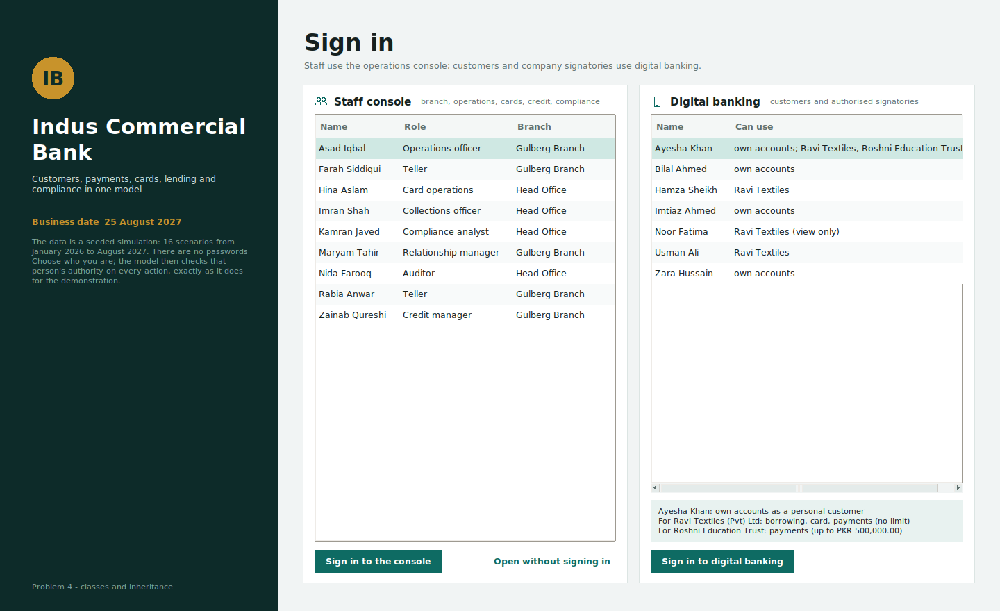

**Figure 10. Overview, signed in as a compliance analyst:** tiles, charts, the payments that need attention (release and reject act as the signed-in officer) and the activity feed.

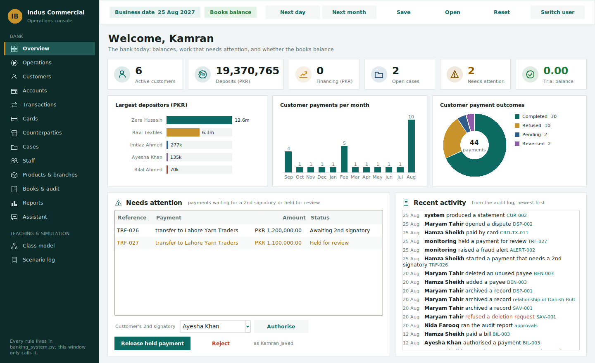

**Figure 11. An operation form for a signed-in relationship manager:** only her role's forms are listed, and she is recorded as the member of staff without being asked.

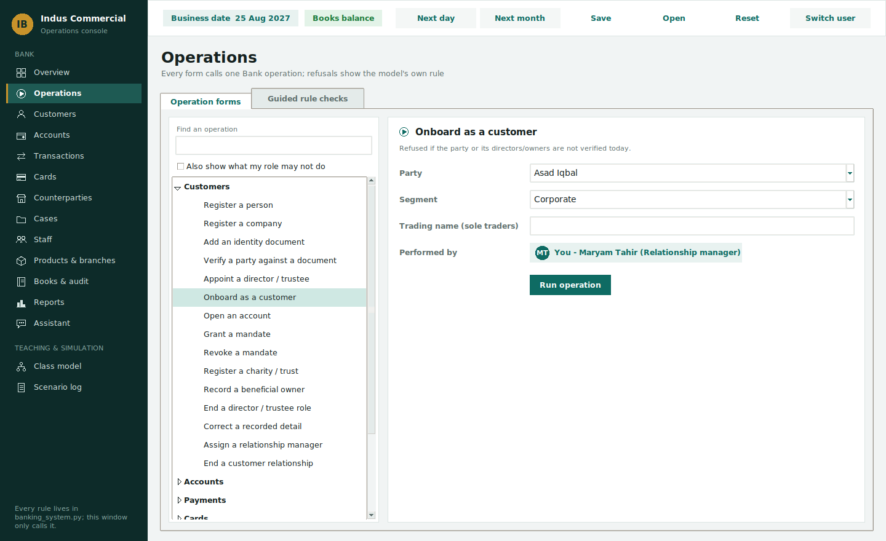

**Figure 12. Guided rule checks:** each runs one real operation and shows the model's answer.

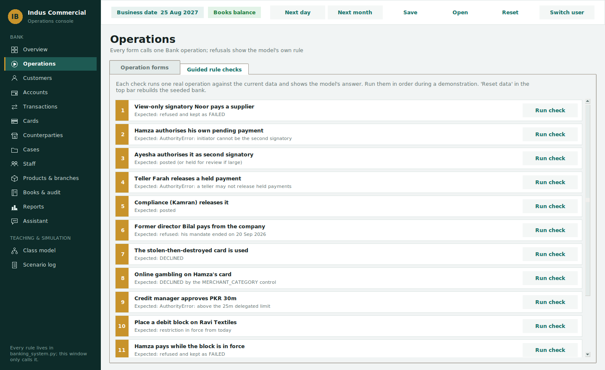

**Figure 13. One customer, many dated roles:** capacities, timeline ribbons and the time machine.

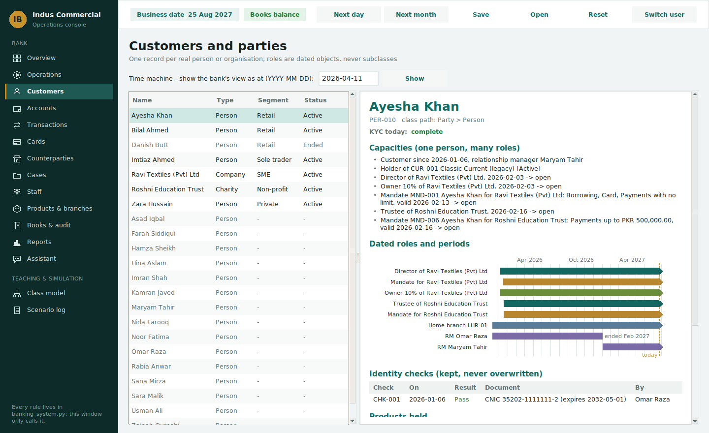

**Figure 14. Card replacement chain:** every payment on every card in the chain stays searchable.

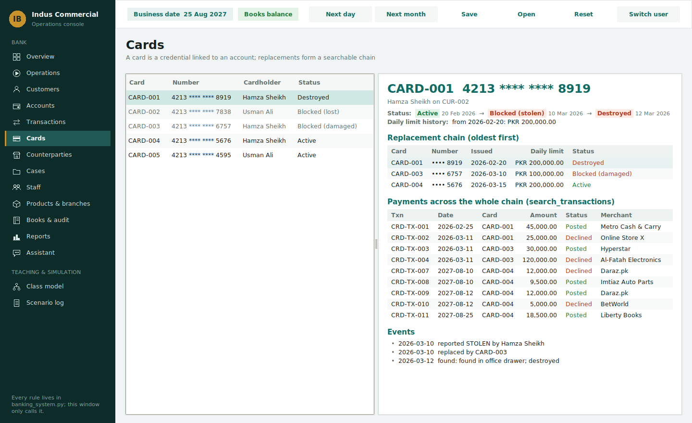

**Figure 15. Books and audit:** the trial balance totals zero; the audit log records what changed, who did it and why.

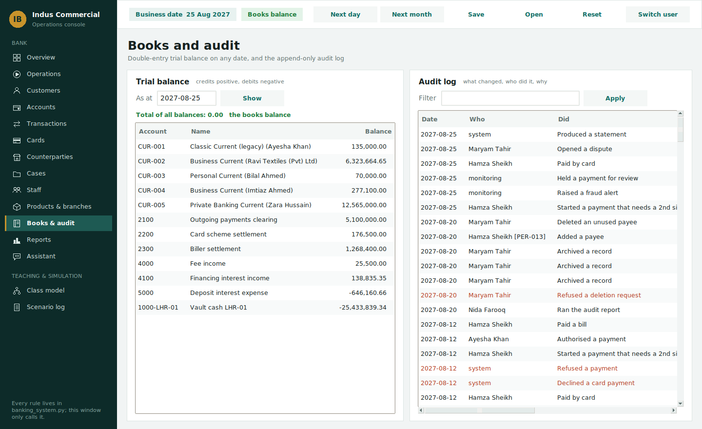

**Figure 16. Reports:** what Bilal could do for Ravi Textiles on 11 April 2026, while he was still a director. The same question for August 2027 answers "no mandate in force".

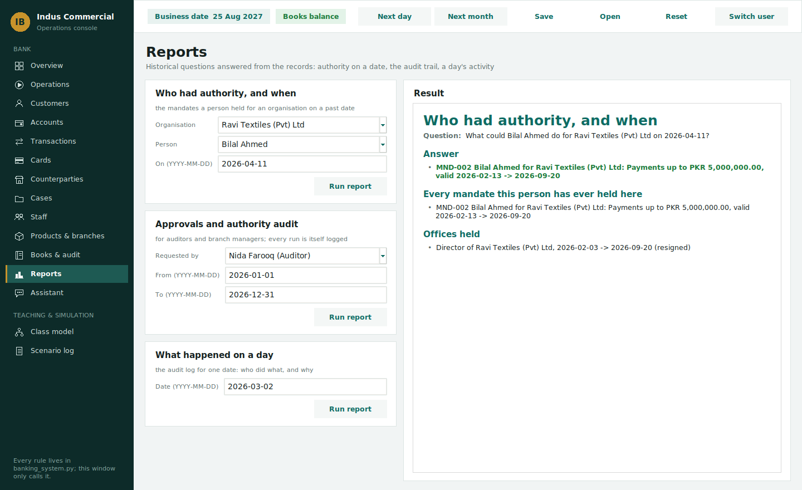

**Figure 17. Counterparties:** a merchant is a standalone counterparty, not a `Party`; its page shows the card used and the merchant refund on its payment.

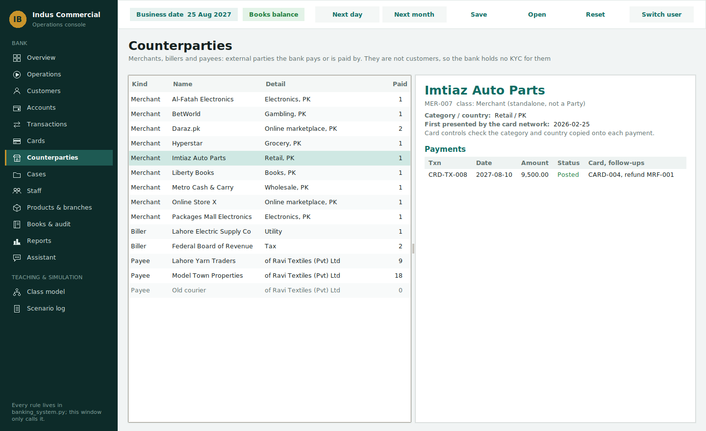

**Figure 18. Class model (teaching section):** `CustomerPayment` is marked abstract, with what it adds, the lifecycle it declares and its subclasses.

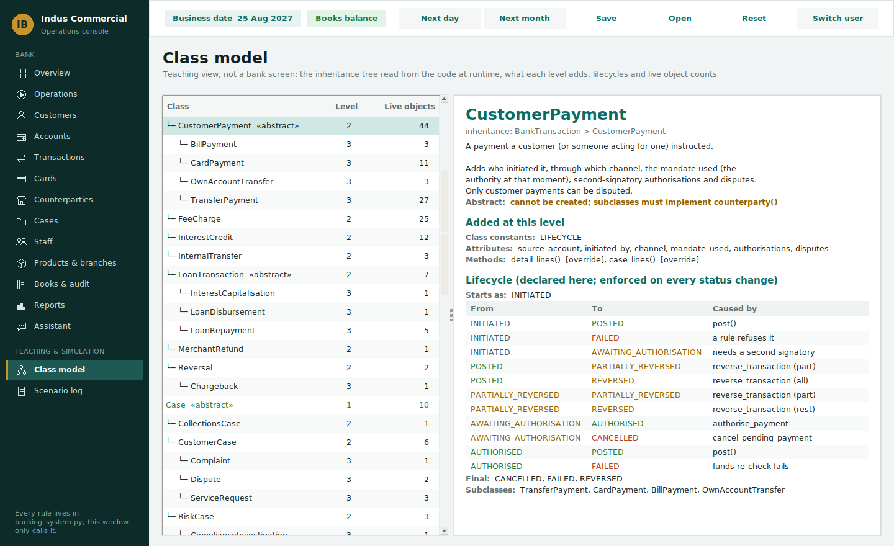

**Figure 19. Digital banking, signed in as Hamza:** the company account he may use, with what his mandate allows, and its recent activity.

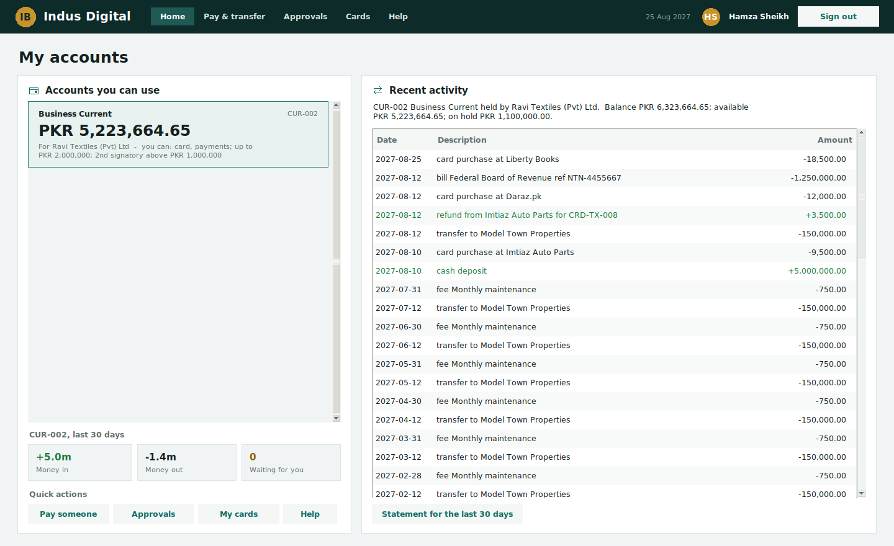

**Figure 20. My cards:** the card, its controls (switched on and off by the cardholder) and every payment across the replacement chain, with a dispute button.

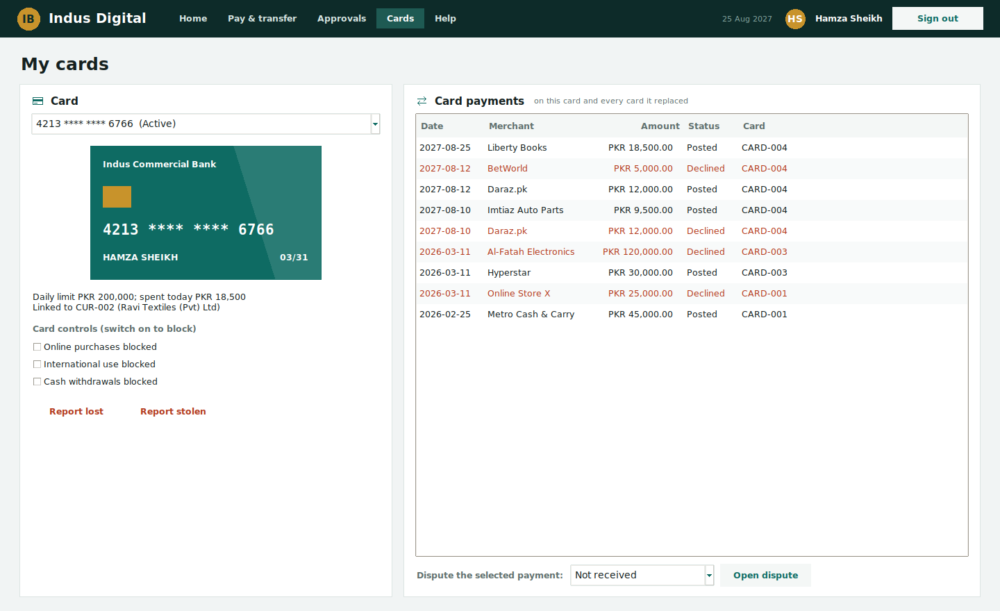

**Figure 21. Approvals, signed in as Ayesha:** Hamza's PKR 1,200,000 payment waits for her as the second signatory; the model refuses Hamza approving his own.

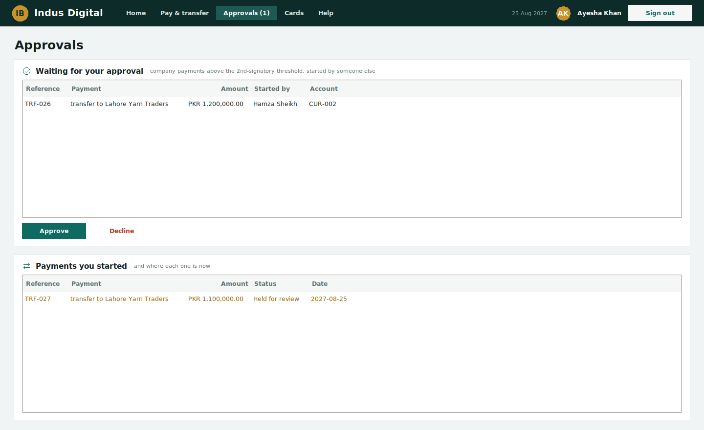

### 11.1 AI assistant (optional automation)

`banking_assistant.py` adds an assistant to the console (and to the terminal). A member of staff asks about a record in plain words, or asks for an operation, and the assistant answers from the bank's own records or prepares the form. It is optional: the project runs without it, and without an internet connection.

**Designed as a hierarchy, for the same reasons as the model.**

| Class | Inherits from | What the level adds |
|---|---|---|
| `Assistant` | (abstract) | The conversation, kept in order and never overwritten (`Exchange`); retrieval of the records a question names, by reference number or name, described through the model's own methods (`transaction_story`, `capacities_of`, `lineage`...); `ask()` as a template method |
| `OfflineAssistant` | `Assistant` | Answers by rule (why a payment was refused, what records show) and turns requests such as "deposit 5,000 into CUR-001" or "report CARD-004 stolen" into a `FormAction`. Needs no package, key or internet |
| `ClaudeAssistant` | `OfflineAssistant` | Sends the question and only the retrieved facts to Claude (`claude-opus-5`, Anthropic's official `anthropic` package), which writes the answer, in Urdu or Roman Urdu if asked in them. It *is* an offline assistant that writes better answers, so it inherits retrieval and form parsing, and falls back to the offline answer when Claude cannot be reached or declines |

`FormAction`, `Reply` and `Exchange` are standalone value classes. `ClaudeAssistant` extends `OfflineAssistant` rather than being a sibling because it needs every offline behaviour: the fallback answer, the retrieval and the form parser.

**Rules that keep the bank's rules in charge.**

- **Reads and pre-fills only.** The assistant cannot run an operation. It prepares one of six listed forms (`FORMS`), and never the "performed by" field. A person checks the form and presses Run, so authority checks, refusals and the audit log apply exactly as for a form filled by hand.
- **Validated suggestions.** A suggestion from Claude that names another operation or field is discarded, never run.
- **Minimum data.** Claude sees only the facts retrieved for the question, not the whole bank.
- **No secrets in the code.** The API key is read from the environment on the user's computer.

**No libraries here either.** A request is read word by word ("deposit", an amount such as "5k" or "2.5 lakh", "into", an account reference) instead of with regular expressions, Claude's suggested form is read with the model's own `Json` reader, and the tests run on the model's own `TestRunner`.

**Tested without the internet.** Nine unit tests (`python banking_assistant.py --test`, run on GitHub for every push) cover the refusal explanation, form preparation that posts nothing, the rejected suggestion, the fallback when Claude is unreachable, and the kept conversation. In them Claude is replaced by a stand-in object. The GUI smoke test asks the assistant for a deposit, opens the prepared form, runs it and checks that exactly one PKR 5,000 deposit was posted.

**Figure 22. The assistant:** it explains a refused payment from the record, lists the payments waiting, and prepares a deposit form that the user opens, checks and runs.

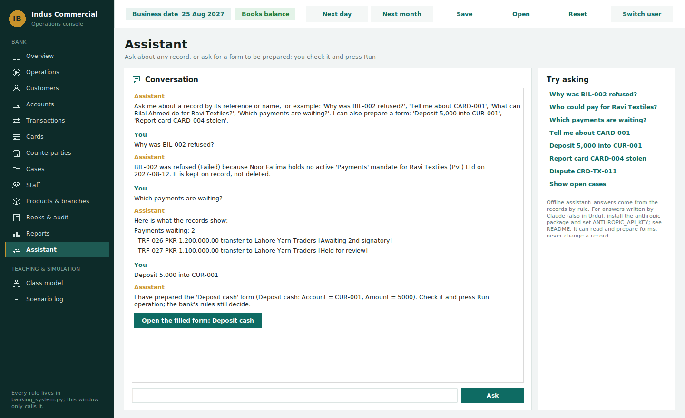
